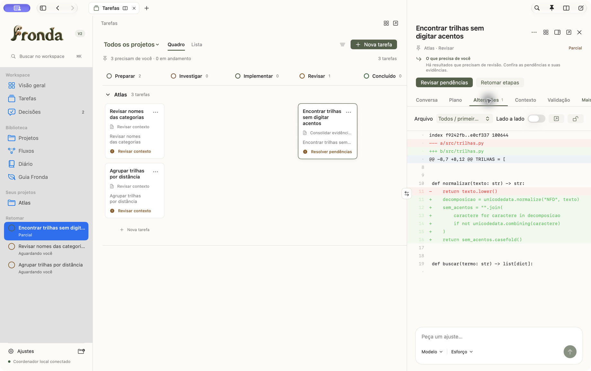
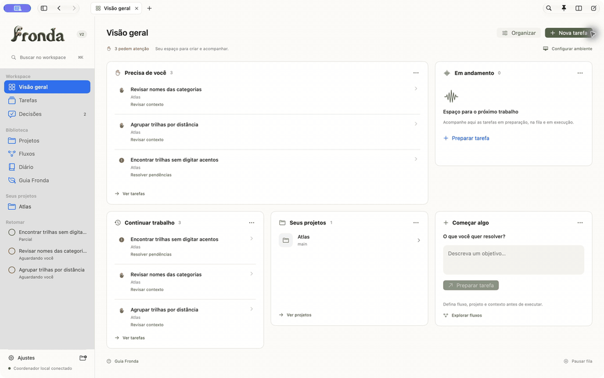
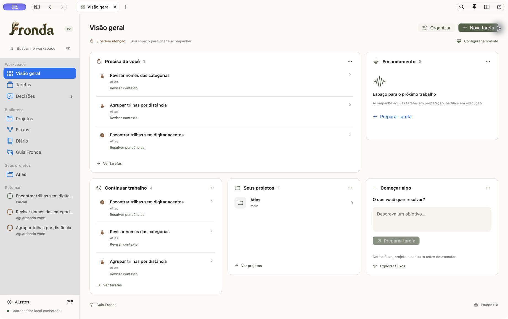
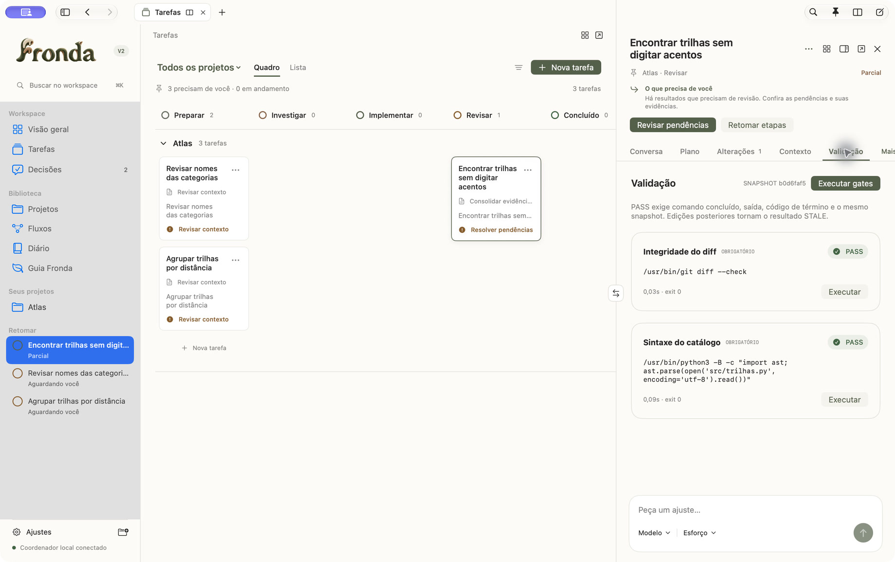

<h1 align="center">
  
</h1>

<p align="center"><strong>Um workspace nativo para acompanhar agentes de programação no macOS.</strong></p>

<p align="center">
  Prepare o contexto, acompanhe cada etapa e revise as mudanças em worktrees Git isoladas.
</p>

<p align="center">
  <a href="#interface">Interface</a> ·
  <a href="#abrir-o-fronda">Abrir o Fronda</a> ·
  <a href="#primeira-tarefa">Primeira tarefa</a> ·
  <a href="#documentação">Documentação</a>
</p>

<picture>
  <source media="(prefers-color-scheme: dark)" srcset="docs/media/fronda-workspace-escuro.jpg">
  
</picture>

<p align="center"><sub>Quadro de tarefas e diff da worktree lado a lado.</sub></p>

## Interface

**Do quadro à validação.** Em 16 segundos, a gravação passa pela Visão geral, abre uma tarefa ao lado do quadro e mostra o plano, o diff e os resultados de dois comandos executados localmente no projeto fictício Atlas.

[Assistir à demonstração em MP4](docs/media/fronda-demo.mp4?raw=true)

<details>
<summary>Ver a prévia animada no README</summary>



</details>

<details>
<summary>Ver mais capturas da interface</summary>

**Visão geral** reúne tarefas recentes, decisões pendentes e projetos.



**Validação** mostra cada comando e seu resultado no snapshot da worktree.



</details>

## Abrir o Fronda

Você precisa de **macOS 15 ou posterior**, Git, Python 3 e Xcode com as Command Line Tools configuradas. A versão usada nas capturas foi compilada com Xcode 27.2.

Execute o script na raiz do repositório.

```sh
./script/build_and_run.sh
```

O script gera `dist/Fronda.app` e `dist/fronda`. Use `./script/build_and_run.sh --build-only` para compilar e empacotar. O botão **Run** do Codex usa o mesmo script.

O pacote local é assinado ad hoc para desenvolvimento. No QA documentado, a notarização e os cenários autenticados de Claude Code, GitHub e Jira ficaram em aberto. [Relatório de QA](docs/QA.md) · [Operação e distribuição](docs/OPERATIONS.md)

A abertura normal usa `~/Library/Application Support/Harness`. Use uma pasta temporária para abrir o Fronda em um ambiente separado e vazio.

```sh
fronda_demo_root="$(mktemp -d)"
open -n dist/Fronda.app --args --fronda-data-root "$fronda_demo_root"
```

## Primeira tarefa

1. **Adicione um projeto.** Selecione um repositório Git com pelo menos um commit. Confira as permissões de acesso e os comandos de validação do projeto.
2. **Prepare o trabalho.** Abra **Nova tarefa** (`⌘N`), escolha um fluxo, um provider e o escopo, e escreva os critérios de aceite. Tarefas que escrevem recebem uma worktree própria a partir do commit base.
3. **Aprove o envio.** Inspecione o contexto, o **Payload exato**, o destino e o orçamento. Nos fluxos guiados, a investigação fundamenta o plano que você revisa para autorizar a implementação.
4. **Revise o resultado.** Abra as alterações, confira as validações e vincule as evidências aos critérios. Uma mudança no snapshot invalida os resultados anteriores.
5. **Prepare a entrega.** Exporte o pacote de evidências com manifesto e hashes. Commit, push, PR e ações no Jira têm confirmações individuais.

Use `⌘K` para buscar tarefas, projetos e comandos, e `⌘T` para abrir uma aba. No quadro, clicar em um card abre a tarefa ao lado. [Workspace com abas e quadro](docs/WORKSPACE-TABS-KANBAN.md)

## CLI

A CLI e a interface usam o mesmo coordenador local por XPC. `--root DIRETÓRIO` aponta a CLI para um ambiente separado.

```sh
./dist/fronda projects
./dist/fronda project add /caminho/para/MeuProjeto
./dist/fronda create MeuProjeto 'Corrigir a saudação' \
  --runbook 'Corrigir bug' --provider Codex --scope src/greet.ts \
  --criterion 'Nome vazio usa o valor padrão'
./dist/fronda inspect RUN_ID
./dist/fronda approve-plan RUN_ID SEQUENCIA_REVISADA
./dist/fronda validate RUN_ID
./dist/fronda export RUN_ID
```

`./dist/fronda help` lista os comandos. `fronda rpc` recebe um `RPCRequest` JSON pela entrada padrão.

## Desenvolvimento

O app usa **Swift 6, SwiftUI e AppKit**. O script `script/generate_xcode_project.py` gera o projeto Xcode, com os parsers Tree-sitter vendorizados no repositório.

```sh
./script/validate.sh
./script/validate.sh --unit-only
./script/lint.sh
```

A validação completa roda lint, XCTest, XCUITest, build e verificação da assinatura ad hoc. Para executar o XCUITest, mantenha a sessão gráfica desbloqueada. O modo `--unit-only` roda lint e XCTest. Os resultados ficam em `.build/qa/run-*/unit.xml` e `.build/qa/run-*/Harness.xcresult`.

## Documentação

| Para consultar | Onde encontrar |
| --- | --- |
| Jornada da tarefa, etapas e decisões | [Experiência V2](docs/V2-EXPERIENCE.md) · [Fluxo de uma tarefa](docs/CARD-WORKFLOW.md) |
| Codex, Claude Code, modelos e contexto importado | [Configuração de providers](docs/ONBOARDING-PROVIDERS.md) |
| Extensões e ferramentas | [Extensões](docs/EXTENSIONS.md) |
| Arquitetura, armazenamento e limites | [Implementação](docs/IMPLEMENTATION.md) · [Especificação](docs/SPEC.md) |
| GitHub, Jira, assinatura e distribuição | [Operação](docs/OPERATIONS.md) · [QA](docs/QA.md) |
| Identidade visual e compatibilidade com Harness | [Marca Fronda](docs/FRONDA-REBRAND.md) |
