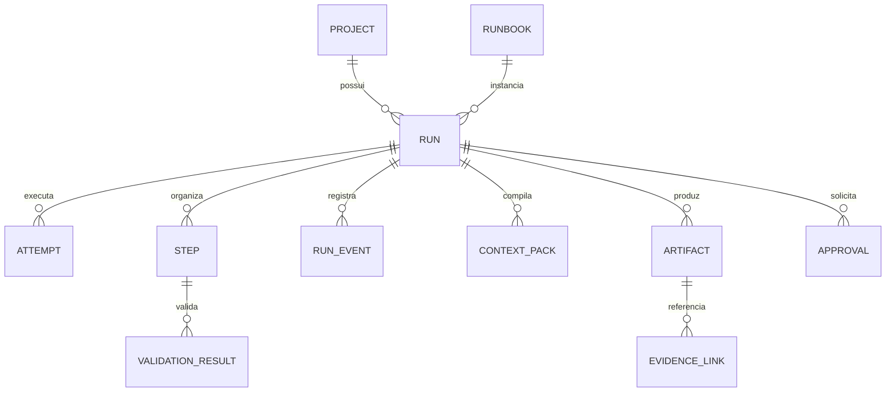
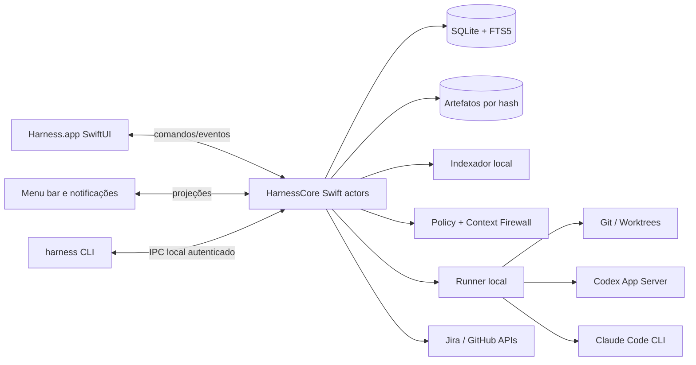

# Harness — especificação de produto, arquitetura e experiência macOS

**Estado:** especificação do produto inicial completo · **Idioma:** pt-BR · **Data:** 22/09/2026

> **Premissa de entrega:** a primeira distribuição pública do Harness inclui todas as capacidades descritas neste documento, integradas e utilizáveis. A implementação pode ser organizada em frentes de trabalho internas, mas nenhuma delas constitui uma versão reduzida do produto.

## 1. Definição do produto

Harness é um ambiente nativo de desenvolvimento assistido por agentes para macOS. O usuário fornece uma intenção — card do Jira, PR, falha de CI, bug, screenshot, refatoração, investigação ou pedido livre — e o Harness cria uma **run** com contexto selecionado, plano, execução, validação, revisão e evidências. Claude Code e Codex são executores conectados. O Harness mantém a identidade da run, aplica políticas, administra worktrees, organiza artefatos e apresenta o estado ao usuário.

### 1.1 Promessa verificável

Uma run concluída permite responder, sem reconstruir uma conversa longa:

1. Qual era o objetivo e quais critérios de aceite foram usados?
2. Que contexto foi enviado a cada provider, de onde veio e por quê?
3. Que comandos e alterações aconteceram, em qual worktree e sobre qual base Git?
4. Quais validações foram executadas, quais passaram, falharam, foram bloqueadas ou não rodaram?
5. O que mudou fora do escopo aprovado?
6. Quantos tokens foram informados pelo provider, quantos foram estimados e qual foi a base da estimativa?
7. O que ainda exige decisão humana antes de commit, push, PR ou atualização do Jira?

### 1.2 Público e cenários

Usuário principal: desenvolvedor individual que trabalha em vários repositórios e alterna entre Claude Code e Codex. Usuário secundário: líder técnico que revisa runs, evidências e propostas de mudança no próprio Mac. O produto atende código, documentação técnica, diagnóstico, revisão e investigação. Não pressupõe que todo trabalho produza alteração de arquivos.

### 1.3 Princípios de produto

| Princípio | Consequência na interface e no core |
|---|---|
| Artefatos antes de chat | Plano, diff, validação e evidência são objetos navegáveis; conversa é uma ação contextual. |
| Estado observável | Cada operação tem estado, responsável, origem e resultado. |
| Contexto mínimo suficiente | Busca e análise determinística local precedem chamadas ao modelo. |
| Métrica honesta | Consumo real, estimativa e economia contrafactual são classes diferentes. |
| Autonomia graduada | O usuário escolhe permissões; operações externas de escrita exigem revisão da carga útil. |
| Local-first | Dados, índice, eventos e artefatos ficam no Mac; serviços externos são acionados por integração explícita. |
| Recuperação sem apagar evidências | Retomada e correção produzem novos eventos e snapshots. |
| Comportamento fiel às capacidades | A UI expõe apenas controles implementáveis pelo provider/estado atual. |

### 1.4 Limites assumidos

- **Plataforma:** macOS 15 ou superior, Apple Silicon e Intel, app SwiftUI distribuído fora da Mac App Store, assinado e notarizado. Essa é uma **decisão de produto** para permitir integração com ferramentas de desenvolvimento já instaladas; exige validação de empacotamento e políticas corporativas antes do lançamento.
- **Conta Harness:** inexistente. Não há backend, sincronização própria ou telemetria obrigatória.
- **Providers incluídos:** instalação local existente de Claude Code e Codex; o Harness verifica versão, autenticação e capacidades antes de usar. O produto não redistribui os binários nem lê arquivos de sessão/autenticação deles.
- **Conectores:** Jira Cloud, GitHub.com/GitHub Enterprise e repositórios Git locais. URLs corporativas e permissões são configuradas por conexão.
- **CLI:** `harness` acompanha o app e usa o mesmo core e o mesmo banco local, com controle de concorrência. A UI continua sendo a experiência principal.
- **Linguagens:** indexação estrutural de TypeScript/TSX, JavaScript/JSX, Swift, Python e Go; para outras linguagens, busca lexical, mapa de arquivos, Git e configuração manual de validadores continuam funcionais. A UI explicita o nível do índice por projeto.

## 2. Objetivos, métricas e critérios de produto

### 2.1 Objetivos

- Reduzir trabalho manual de montar contexto e acompanhar agentes, preservando a decisão humana sobre mudanças.
- Tornar a execução auditável até o nível de requisito → decisão → diff → validação.
- Permitir runs simultâneas sem conflito entre alterações.
- Economizar tokens com índice, cache e prompts enxutos, sem perder arquivos ou critérios relevantes.
- Suportar atividades de leitura, implementação, depuração, revisão, recuperação de CI e exploração visual no mesmo modelo de run.

### 2.2 Indicadores medidos localmente

| Indicador | Definição | Meta de aceite para o lançamento |
|---|---|---|
| Tempo até primeiro contexto | Da confirmação do objetivo à exibição do Context Pack | p95 < 10 s em índice aquecido de 50 mil arquivos elegíveis, em máquina de referência definida para QA. |
| Visibilidade | Eventos relevantes com estado e artefato navegável | 100% das transições de run e decisões de permissão persistidas. |
| Isolamento | Runs de escrita simultâneas com worktrees distintos | Nenhuma escrita cruzada observada na suíte de cenários de lançamento. |
| Rastreabilidade | Arquivo modificado relacionado a requisito, plano ou decisão | 100% dos arquivos alterados classificados; lacunas ficam como “sem vínculo” e impedem selo de evidência completa. |
| Integridade de validação | Status derivado de processo observado | Nenhum `PASS` sem comando, saída, código de término e revisão do snapshot correspondente. |
| Economia de contexto | Tokens de entrada com/sem seleção no corpus de benchmark | Comparativo reproduzível por tarefa; meta de redução definida sobre corpus fixo, sem alegar economia monetária quando o preço não é conhecido. |
| Recuperação | Reinício do app durante run | A UI reconstrói o último estado confirmado e oferece retomar, reconciliar ou encerrar. |

As metas de desempenho são critérios de teste do produto, não números já medidos. O corpus, hardware, versões dos providers e método de coleta devem acompanhar cada resultado de QA.

## 3. Unidades conceituais e domínio

### 3.1 Objetos

| Objeto | Campos essenciais | Regra |
|---|---|---|
| `Project` | id, nome, bookmark/path, remotes, branch padrão, regras, validadores, conectores | Representa um repositório ou workspace local. |
| `SourceIntent` | tipo, texto, links, anexos, revisão da fonte | Entrada imutável capturada antes da run. |
| `Runbook` | id, versão, etapas, critérios, permissões, estratégia | Template editável e versionado. Uma run guarda cópia da versão usada. |
| `Run` | id, projeto, runbook, origem, base SHA, estado, prioridade, orçamento, timestamps | Identidade estável de uma execução. Seus eventos são imutáveis; a projeção de estado muda. |
| `Attempt` | id, runId, provider, sessão externa, start/end, resultado | Uma run pode ter novas tentativas ou troca de provider sem perder histórico. |
| `Step` | id, runId, tipo, dependências, estado, entradas/saídas | Unidade de invalidação, retry e progresso. |
| `WorkspaceLease` | runId, caminho, branch, base SHA, lock, ownership | Evita edição simultânea do mesmo workspace. |
| `ContextNode`/`Edge` | arquivo/símbolo/requisito/regra, origem, revisão, relação | Grafo local usado por busca e Inspector. |
| `ContextPack` | id, versão, itens, ordem, hashes, orçamento, exclusões | Snapshot exato do conteúdo oferecido ao provider. |
| `Plan`/`Decision` | passos, critérios, revisão, autor, justificativa | Steering cria revisão, nunca substitui o passado. |
| `Artifact` | id, tipo, hash, MIME, tamanho, path local | Conteúdo endereçado por hash e referenciado por eventos. |
| `ValidationResult` | comando, ambiente, SHA/diff hash, duração, saída, status | Resultado válido somente para o snapshot em que rodou. |
| `ReviewFinding` | severidade, arquivo/linha, evidência, estado | Revisão humana ou automatizada com autor explícito. |
| `Approval` | ação, carga útil, escopo, concedente, expiração | Aprovação vinculada a operação concreta e revisão exata. |
| `TokenRecord` | provider, modelo, etapa, entrada/saída/cache, fonte, custo | Nunca mistura valor reportado com estimativa. |

### 3.2 Relações e invariantes



- O `RunEvent` é anexado uma única vez, recebe sequência monotônica por run e não é alterado.
- O `Run` usa uma projeção reconstruível dos eventos; “imutável” significa identidade e histórico, não estado congelado.
- `RunReady` só pode existir se o diff vigente, a revisão, o Scope Guard e os validadores obrigatórios apontarem para a mesma revisão de workspace.
- Qualquer alteração de arquivo após validação marca resultados afetados como **obsoletos**, mesmo que antes fossem `PASS`.
- `Approval` para commit, push, PR ou Jira só vale para o hash da proposta aprovada; se conteúdo/branch/base mudar, precisa de nova revisão.
- O mesmo worktree de escrita não pode ser adquirido por duas runs ativas. Runs de leitura podem compartilhar repositório e índice.
- Uma run pode terminar com `READY`, `PARTIAL`, `FAILED`, `CANCELLED` ou `BLOCKED`; ausência de erro não implica `READY`.

### 3.3 Estados

| Nível | Estados |
|---|---|
| Run | `DRAFT`, `QUEUED`, `PREPARING`, `RUNNING`, `WAITING_USER`, `PAUSED`, `RECOVERING`, `READY`, `PARTIAL`, `FAILED`, `CANCELLED`, `BLOCKED`, `ARCHIVED` |
| Step | `PENDING`, `RUNNING`, `PASS`, `FAIL`, `SKIPPED`, `BLOCKED`, `STALE`, `CANCELLED` |
| Validation | `NOT_RUN`, `RUNNING`, `PASS`, `FAIL`, `BLOCKED`, `STALE` |
| Provider | `AVAILABLE`, `AUTH_REQUIRED`, `VERSION_UNSUPPORTED`, `OFFLINE`, `RATE_LIMITED`, `UNAVAILABLE` |

Transições principais: `DRAFT → QUEUED → PREPARING → RUNNING`; `RUNNING ↔ WAITING_USER`, `RUNNING → PAUSED`, `PAUSED → RUNNING`, `RUNNING → RECOVERING`, e então um estado terminal. `ARCHIVED` é uma marca de organização posterior. `PAUSED` é um **checkpoint lógico**: a run não inicia novo passo; se o provider não oferece suspensão real, o turno corrente é interrompido e retomado posteriormente com novo `Attempt`. A UI mostra essa diferença.

## 4. Requisitos funcionais

### 4.1 Entrada, projetos e runbooks

| ID | Requisito e aceite observável |
|---|---|
| RF-01 | Criar run a partir de texto, Jira issue, URL/PR GitHub, seleção de diff, falha de validação, arquivo, pasta, screenshot ou referência de log. O assistente de criação mostra fonte reconhecida, projeto provável, runbook sugerido, escopo e permissões antes de iniciar. |
| RF-02 | Cadastrar vários projetos por seletor de pasta; detectar Git, remotes, ferramentas disponíveis, regras e comandos sem executar scripts de instalação. Exibir branch, status de alterações locais, estado do índice e credenciais necessárias. |
| RF-03 | Disponibilizar runbooks prontos: Implementar issue, Corrigir bug, Corrigir teste, Revisar PR, Refatorar, Explorar código, Implementar UI, Investigar incidente, Atualizar dependência, Recuperar CI, Performance e Personalizado. Todos são operáveis; o tipo define etapas, gates e modo padrão. |
| RF-04 | Editor de runbooks com grafo acíclico de etapas, condições, comandos de validação, orçamento, provider preferido, retries, política e previsualização; valida sintaxe/dependências e guarda revisões. |
| RF-05 | Command Center agrega runs em execução, fila, ações pendentes, últimas falhas e projetos. Busca global e `⌘K` abrem projeto, run, comando, runbook ou ação contextual. |

### 4.2 Contexto e índice

| ID | Requisito e aceite observável |
|---|---|
| RF-06 | Indexar incrementalmente arquivos elegíveis, símbolos, imports, referências locais, testes associados, regras e histórico Git. Respeitar `.gitignore`, exclusões do projeto, limites de arquivo e firewall. Mostrar cobertura e erros. |
| RF-07 | Context Compiler produz pack com objetivo, critérios, regras, snippets/símbolos, arquivos inteiros quando necessários, diff, erros relevantes e proveniência. Mostra tokens previstos e motivo de cada inclusão/exclusão. |
| RF-08 | Context Graph permite buscar, filtrar relações, pin/unpin, abrir arquivo, travar arquivo contra escrita e explicar relevância. Mudanças manuais geram nova revisão do pack. |
| RF-09 | Context Inspector mostra payload exato por tentativa, origem, hashes, classificação de sensibilidade, orçamento e histórico de compactações. Antes do envio, informa destinos/provedores. |

### 4.3 Execução e steering

| ID | Requisito e aceite observável |
|---|---|
| RF-10 | Executar Claude Code e Codex por adapters, com streaming de atividade, perguntas/aprovações, cancelamento, retomada quando suportada, detecção de autenticação/versão e estado de indisponibilidade. |
| RF-11 | Planejar, revisar e editar passos antes da execução; vincular cada passo a critérios de aceite, escopo de arquivos, dependências e validações. |
| RF-12 | Criar worktree por run de escrita, registrar base SHA, branch, lock e alterações iniciais. Não tocar em alterações não relacionadas do checkout do usuário. |
| RF-13 | Permitir runs paralelas, fila, limite de concorrência global/por projeto/por provider e pausa de agendamento. Cada run tem painel e eventos próprios. |
| RF-14 | Steering contextual em plano, diff, finding e validação: explicar, corrigir, restringir escopo, tentar novamente, pular com justificativa, trocar provider e bifurcar abordagem. Ações criam eventos e invalidam apenas artefatos dependentes, calculados por grafo. |
| RF-15 | Comparar duas abordagens em worktrees separados com métricas de diff, validação, risco e tokens; usuário escolhe uma. Nenhum merge silencioso entre abordagens. |
| RF-16 | Timeline apresenta eventos sem expor log bruto por padrão. Replay reconstrói estados e artefatos de cada momento, inclusive falhas, perguntas e aprovações, mas não reexecuta comandos automaticamente. |

### 4.4 Revisão e resultado

| ID | Requisito e aceite observável |
|---|---|
| RF-17 | Diff Viewer nativo com comparação base/HEAD + working tree, lista de arquivos, lado a lado/unificado, seleção por trecho, comentários locais e vínculo com requisitos/decisões. Binários aparecem por metadados/Quick Look quando possível. |
| RF-18 | Scope Guard compara arquivos e comandos ao escopo permitido; detecta dependências, lockfiles, migrações, CI, remoções, mudanças em credenciais e paths externos. Bloqueio ou pedido de aprovação é decidido por política, nunca somente por modelo. |
| RF-19 | Validation Engine executa comandos configurados sem shell por padrão, registra stdout/stderr locais, exit code, tempo, ambiente e revisão validada; parseia diagnósticos conhecidos e preserva log integral local. |
| RF-20 | Review Engine combina verificações determinísticas, revisão independente por provider e revisão humana. Achados têm severidade, evidência e resolução; sem parecer conclusivo quando validações estão incompletas. |
| RF-21 | Evidence Engine liga critérios → contexto → decisão → trecho alterado → validação → finding → resultado. Exporta pacote local redigido, com manifesto, hashes, relatório e trilha de auditoria. |
| RF-22 | Tela de conclusão mostra `READY`, `PARTIAL`, `FAILED`, `BLOCKED` ou `CANCELLED`, razões e ações possíveis. Commit, push, criação de PR e atualização do Jira são ações explícitas com prévia exata. |

### 4.5 Economia, integrações e macOS

| ID | Requisito e aceite observável |
|---|---|
| RF-23 | Token Ledger por run/etapa/provider/modelo exibe entrada, saída, cache e custo quando reportados; estimativas são rotuladas. Orçamento avisa, reduz contexto opcional e interrompe novos passos conforme política. |
| RF-24 | Jira lê issue, comentários selecionados, critérios e anexos autorizados; GitHub lê PR, diff, comentários e checks; Git administra status, branch, worktree e commits locais. Escritas externas são propostas auditáveis. |
| RF-25 | Menu bar mostra runs ativas, espera por usuário, fila e ações rápidas. Notificações locais são configuráveis para decisão, término, falha e orçamento; clique abre run/contexto correto. |
| RF-26 | Settings concentra providers, integrações, projetos, permissões, cache, orçamento, privacidade, notificações, atalhos, aparência e diagnósticos. Suporta claro/escuro, VoiceOver, teclado e redução de movimento. |
| RF-27 | CLI permite criar/abrir run, consultar status, validar e exportar evidências sem duplicar o motor. Comandos mutáveis obedecem às mesmas políticas e aprovações da UI. |

## 5. Modos de autonomia e políticas

| Modo | Leitura/contexto | Escrita local | Validação | Decisões externas |
|---|---|---|---|---|
| Explorar | Permitida nos paths autorizados | Não | Apenas diagnósticos de leitura | Não |
| Planejar | Permitida | Somente artefato de plano no armazenamento do Harness | Opcional e somente leitura | Não |
| Guiado | Permitida | Após aprovação do plano e da política de paths | Executa comandos aprovados | Aprovação por transação |
| Auto | Permitida | Em worktree e paths permitidos; pede confirmação para exceções | Executa gates permitidos e correção limitada | Aprovação por transação |
| Confiável | Permissões locais ampliadas e explícitas por projeto | Em worktree, sob regras persistidas | Executa gates definidos | Aprovação por transação |

Política efetiva: **restrição corporativa administrada** (quando houver) > regra global > projeto > runbook > configuração da run. Uma camada inferior pode restringir; só pode ampliar uma camada superior mediante ação explícita que ela permita. Decisões possíveis: `allow`, `ask`, `deny`, com motivo e correspondência a ação/path/domínio. Não usar `bypassPermissions` como atalho. Uma recusa do provider não vira autorização do Harness, e uma autorização do Harness não desativa as proteções nativas do provider.

Padrões: leitura de projeto e diff permitida; comandos de validação cadastrados permitidos; edição apenas em worktree; rede do provider conforme sua política; instalação de dependências, mudança de `package.json`/lockfile, migrações, CI, exclusão de arquivos e acesso fora do projeto exigem ação explícita; extração de segredos, `push --force` e deleção do repositório são negados. Para commit, push, PR e escrita no Jira, mostrar operação, destino, diff/corpo e escopo; confirmação vale para aquele hash. Ausência do usuário deixa `WAITING_USER` sem tempo limite para aprovar automaticamente.

## 6. Arquitetura técnica

### 6.1 Processos e distribuição



O app é um target Xcode Swift 6/SwiftUI com `WindowGroup` principal, `Settings` e `MenuBarExtra`. Swift Concurrency e `@Observable` mantêm o estado de apresentação; regras de negócio ficam em pacotes Swift separados da UI. `NavigationSplitView` e Inspector nativo compõem o workspace. O menu bar é uma janela de acesso rápido, não um segundo orquestrador. As APIs de cena e Inspector têm suporte no alvo macOS adotado. [Referência SwiftUI da Apple](https://developer.apple.com/documentation/swiftui/menubarextra).

**Runtime:** um processo coordenador por usuário mantém banco, leases e fila; app e CLI se conectam por XPC local com assinatura/identidade verificadas. O coordenador só é instalado para o usuário e inicia quando app ou CLI precisa dele. Processos de provider são filhos do Runner, com diretório de trabalho, ambiente mínimo, stdout/stderr drenados de forma assíncrona, timeout e grupo de processo para cancelamento. O término da janela não encerra runs; “Sair e parar runs” é opção separada. No login, iniciar automaticamente é opt-in via mecanismo nativo. [SMAppService](https://developer.apple.com/documentation/servicemanagement/smappservice).

**Sandbox e distribuição:** integração com executáveis do usuário não deve ser anunciada como confinamento macOS App Sandbox sem prova. A distribuição direta com hardened runtime, assinatura e notarização é a opção inicial; Harness aplica permissões no próprio broker e usa os controles/sandboxes dos providers. Isso **não torna um processo de terceiros plenamente contido**. Operações para as quais a política exige isolamento forte e o provider não demonstra enforcement verificável ficam `BLOCKED`. Projeto corporativo pode desativar provider ou rede. A restrição de execução de programas externos em app sandboxed e os mecanismos de bookmarks são documentados pela Apple; o desenho final de entitlements/assinatura deve ser validado em protótipo de distribuição. [Acesso a arquivos no App Sandbox](https://developer.apple.com/documentation/security/accessing-files-from-the-macos-app-sandbox).

### 6.2 Módulos e propriedade de dados

| Módulo | Responsabilidade | Não faz |
|---|---|---|
| `HarnessUI` | Navegação, comandos, projeções, edição de plano/diff, acessibilidade | Não chama provider ou Git diretamente. |
| `RunCoordinator` | Máquina de estados, DAG de etapas, fila, retries, checkpoints | Não interpreta saída de linguagem. |
| `ProjectRegistry` | Repositórios, bookmarks, regras, ferramentas, conectores | Não indexa conteúdo. |
| `IndexEngine` | Watcher, parsers, hashes, símbolos, FTS5, grafo | Não envia dados à rede. |
| `ContextCompiler` | Recuperação, ranking, seleção, orçamento, pack e proveniência | Não executa modelo. |
| `ProviderGateway` | Adapters Codex/Claude, normalização de eventos e capacidades | Não decide permissão de negócio. |
| `WorkspaceManager` | Worktrees, branches, leases, status, reconciliação | Não apaga checkout do usuário. |
| `PolicyEngine` | Autorizações locais e ações sensíveis | Não interpreta texto de prompt como autorização. |
| `ContextFirewall` | Classificação, exclusões, prévia de egress, redação | Não promete controlar leitura interna de provider externo sem enforcement. |
| `ValidationEngine` | Comandos, parser de diagnósticos, snapshot, status | Não marca sucesso por texto gerado pelo agente. |
| `ReviewEngine` | Scope Guard, heurísticas, revisão independente, findings | Não substitui aceitação humana. |
| `EvidenceEngine` | Vínculos e pacote verificável | Não reescreve eventos. |
| `TokenLedger` | Telemetria de uso e orçamento | Não inventa economia financeira. |
| `Integrations` | Jira/GitHub/Git; OAuth e operações idempotentes | Não escreve externamente sem payload aprovado. |
| `EventStore` | Eventos, projeções, snapshots, migrações | Não armazena segredo em texto claro. |

Dependências permitidas: UI → contratos do core; Coordinator → interfaces de módulos; módulos de infraestrutura implementam interfaces do domínio. Adapters não importam views. Nenhum módulo usa barrel exports ou `index.ts` de reexportação; o app é Swift e os poucos trechos auxiliares importam arquivos diretamente. Não há serviço Node/TypeScript embutido.

### 6.3 Contratos internos

```swift
protocol AgentProvider: Sendable {
    var identity: ProviderIdentity { get }
    func probe() async -> ProviderCapabilities
    func start(_ request: AgentRequest) async throws -> ProviderSession
    func events(for session: ProviderSession) -> AsyncThrowingStream<ProviderEvent, Error>
    func send(_ input: SteeringInput, to session: ProviderSession) async throws -> SteeringReceipt
    func interrupt(_ session: ProviderSession) async throws
    func resume(_ session: ProviderSession, with request: AgentRequest) async throws -> ProviderSession
}

struct AgentRequest: Sendable {
    let runID: UUID
    let stepID: UUID
    let contextPackID: UUID
    let workspaceURL: URL
    let mode: AutonomyMode
    let allowedCapabilities: Set<Capability>
    let budget: TokenBudget
    let outputContract: OutputContract
}
```

`ProviderCapabilities` inclui `liveSteer`, `resume`, `interrupt`, `approvalBridge`, `usageEvents`, `sandboxModes`, `structuredOutput` e versão. Um método do protocolo pode retornar `unsupported`; a UI e o Coordinator usam a matriz observada em `probe()`, nunca a marca do provider como promessa. `ProviderEvent` normaliza início/fim de turno, mensagem, ação, arquivo, comando, pergunta, aprovação, uso, erro e heartbeat; mantém referência ao payload bruto local para diagnóstico.

Outros contratos: `ProjectSource.fetch(SourceRef) -> SourceSnapshot`; `ContextCompiler.compile(ContextRequest) -> ContextPack`; `PolicyEngine.evaluate(Action, Context) -> Decision`; `WorkspaceManager.acquire(WorkspaceRequest) -> WorkspaceLease`; `ValidationEngine.run(ValidationPlan, WorkspaceRevision) -> [ValidationResult]`; `EventStore.append(expectedSequence, events) -> newSequence`. Chamadas mutáveis usam idempotency key, revisão esperada e cancellation token. O app verifica o estado ao reconectar.

Envelope de evento persistido:

```json
{
  "eventId": "uuid-v7",
  "runId": "uuid-v7",
  "sequence": 42,
  "occurredAt": "2026-09-22T18:42:03.114Z",
  "kind": "validation.finished",
  "actor": { "type": "system", "id": "ValidationEngine" },
  "attemptId": "uuid-v7",
  "stepId": "uuid-v7",
  "workspaceRevision": "git-base-sha+diff-sha256",
  "inputArtifactIds": ["artifact-id"],
  "outputArtifactIds": ["artifact-id"],
  "schemaVersion": 1,
  "payload": { "status": "FAIL", "exitCode": 2 }
}
```

Eventos `file.changed` são produzidos pela comparação de filesystem/Git, ainda que o provider não reporte a edição; eventos de provider são observações adicionais. Ordenação entre processos usa sequência do EventStore, não relógio de parede. Artefatos grandes são armazenados por hash; payload do evento guarda referência.

### 6.4 API de comandos, erros e eventos

App e CLI enviam comandos tipados ao Coordinator: `CreateRun`, `StartRun`, `PauseRun`, `ResumeRun`, `CancelRun`, `SteerStep`, `ApproveAction`, `RejectAction`, `RetryStep`, `SelectApproach`, `RunValidation`, `PrepareExternalAction`, `CommitExternalAction`, `ExportEvidence`. Cada comando contém `commandId` idempotente, `actor`, `runId`, `expectedRunRevision` e payload específico. Resposta é `accepted` com sequência de evento ou erro tipado; aceitação significa **comando registrado**, não operação concluída. A UI acompanha evento terminal da ação.

Erros comuns: `REVISION_CONFLICT` (recarregar e reaplicar), `POLICY_DENIED` (mostrar regra), `APPROVAL_REQUIRED` (abrir decisão), `CAPABILITY_UNAVAILABLE` (mostrar requisito de provider), `WORKSPACE_BUSY` (fila ou outro worktree), `SNAPSHOT_STALE` (revalidar), `AUTH_REQUIRED` (reconectar), `RATE_LIMITED` (espera calculada), `EXTERNAL_RESULT_UNKNOWN` (reconciliar antes de repetir). Erro de infraestrutura não vira texto genérico do agente.

Famílias de eventos persistidos: `run.*`, `step.*`, `workspace.*`, `context.*`, `provider.*`, `tool.*`, `permission.*`, `plan.*`, `file.*`, `validation.*`, `review.*`, `evidence.*`, `usage.*`, `integration.*`. Exemplos: `run.created`, `workspace.leased`, `context.pack_compiled`, `provider.turn_started`, `permission.requested`, `permission.decided`, `file.changed`, `validation.finished`, `review.finding_added`, `usage.reported`, `integration.action_confirmed`, `run.ready`. Consumidores ignoram campos adicionais de versão conhecida e recusam `schemaVersion` futuro em evento crítico. Migração registra `upcaster` explícito para projeções antigas; payload bruto continua preservado.

Um `ContextPack` guarda `packId`, `projectId`, `baseSHA`, `workspaceRevision`, `providerProfile`, `stage`, `budget`, `policyRevision`, `items[]` e `excluded[]`. Cada item inclui `kind`, `sourceRef`, `contentHash`, `lineRange`, `classification`, `reason`, `rank`, `estimatedTokens` e `contentArtifactId`; a ordenação de `items[]` é a ordem do envio. `Approval` guarda `actionDigest = SHA-256(canonical(actionType, target, payload, workspaceRevision, policyRevision))`. Antes de executar ação aprovada, o Coordinator recalcula o digest; qualquer divergência invalida a aprovação.

## 7. Índice local, Context Compiler e Context Firewall

### 7.1 Pipeline de indexação

1. **Descoberta:** `git ls-files` e status identificam arquivos rastreados e não rastreados permitidos; `.gitignore`, exclusões do projeto, diretórios de dependência, binários e arquivos sensíveis são aplicados antes da leitura. Arquivos não rastreados não entram automaticamente no contexto remoto.
2. **Fingerprint:** tamanho, mtime e hash SHA-256 de conteúdo; hash é a fonte de validade. Symlinks são resolvidos e recusados se escaparem da raiz autorizada, salvo permissão específica.
3. **Parser:** Tree-sitter com gramáticas fixadas no bundle gera símbolos, imports e ranges para TS/JS/Swift/Python/Go. Falha do parser reduz aquele arquivo a busca lexical e aparece na cobertura. Não usar saída de LLM como AST.
4. **Enriquecimento:** relações de imports, chamadas recuperáveis, teste ↔ fonte por convenção configurável, README/regras e histórico Git local. Relação inferida tem origem e confiança separadas de relação sintática.
5. **Persistência:** metadados e arestas em SQLite; FTS5 indexa texto elegível em segmentos, com atualizações incrementais. Arquivo original continua no repositório. A extensão FTS5 oferece busca de texto e índices external-content, mas a implementação deve manter tabela e índice consistentes. [SQLite FTS5](https://www.sqlite.org/fts5.html).
6. **Atualização:** watcher coalesce eventos; Git HEAD, branch e diff invalidam somente nós/arestas e sumários dependentes. Reindexação total é operação explícita ou resposta a mudança de versão do parser.

O índice tem estados `NOT_INDEXED`, `INDEXING`, `READY`, `DEGRADED`, `STALE`, `ERROR`. Em `DEGRADED`, busca lexical e Git permanecem úteis, mas o Context Inspector identifica relações não disponíveis. O app não envia índice completo ao provider.

### 7.2 Compilação do contexto

Entradas: intenção normalizada e critérios, projeto/base SHA, etapa, plano vigente, diff vigente, regras autorizadas, orçamento por provider, pins/exclusões e eventuais findings. Saída: `ContextPack` determinístico para a mesma revisão de dados e configuração.

**Ranking local inicial:** cobertura de critérios de aceite (peso 5), vizinhança de símbolos/arquivos do alvo (4), linhas do diff/falha (4), teste ou validação relacionada (3), caminho citado na intenção (3), recorrência em exploração anterior validada (2), histórico Git próximo (1). Penalizar arquivo grande, redundância, baixa confiança, gerado e contexto obsoleto. Os pesos são defaults transparentes e editáveis por projeto; podem ser calibrados em benchmark. Seleção usa diversidade: preferir mais requisitos cobertos a múltiplos arquivos quase idênticos. Pins entram obrigatoriamente se política de sensibilidade permitir; excesso de orçamento pede decisão e não trunca regra obrigatória silenciosamente.

**Ordem do pack:** contrato da etapa e regras estáveis → mapa curto da arquitetura → intenção/critério → plano atual → trechos e símbolos relevantes com paths/linhas/hash → diff/diagnóstico atual → perguntas. Toda citação de código informa revisão. Regras de projeto são resumidas somente quando a versão integral não é mandatória; instruções com precedência superior nunca são cortadas para caber no orçamento. Arquivo inteiro só entra quando a operação realmente exige seu conteúdo completo. Contexto antigo é resumido em decisões e resultados verificáveis, com link local ao bruto.

**Invalidação:** alteração em arquivo citado invalida seus snippets e arestas; alteração em critério invalida pack/plano e validações ligadas; steering em passo invalida descendentes no DAG; mudança de base invalida achados dependentes do diff; mudança de provider recompila pack conforme seu tokenizer/capacidades. Resultados não afetados continuam navegáveis, com revisão explícita.

### 7.3 Graph e Inspector

Tipos de nó: requisito, issue/PR, regra, arquivo, símbolo, teste, comando, decisão, diff hunk, finding e artefato. Arestas: `references`, `imports`, `defines`, `tests`, `satisfies`, `motivated_by`, `validated_by`, `changed_by`, `excluded_by`. Visualização permite expandir um salto de cada vez, filtrar e ir para arquivo/linha. “Por que está no contexto?” mostra a cadeia concreta e o score, por exemplo `critério AC-2 → OrdersPage → OrdersFilter`. “Remover” cria exclusão para o pack seguinte; “Travar arquivo” impede escrita e é transmitido como regra ao provider **e** verificado por diff/PolicyEngine.

Inspector possui três abas: **Enviado** (bytes/texto exatos, versão, destino), **Candidatos** (itens avaliados e score) e **Excluídos** (motivo: ignore, regra, sensível, redundante, orçamento). Não deve mostrar segredo redigido. O usuário pode copiar um manifesto redigido do pack, mas exportar texto integral exige confirmação de destino.

### 7.4 Context Firewall e confiança

- Classificação local por path, nome, formato e detectores de padrões: fonte normal, segredo, credencial, dado pessoal, conteúdo externo não confiável. Arquivos de auth, caches de sessão, bancos de apps e logs brutos são excluídos por padrão.
- Conteúdo de Jira, GitHub, README, issue, comentário, log ou arquivo é **dado**, mesmo quando contém frases imperativas. Ele entra delimitado e com origem; não pode alterar políticas, permissões ou instruções de sistema.
- Antes de uma chamada de provider, gerar manifesto de egress: provider, conta configurada, paths, classes de dados, hashes, bytes e estimativa de tokens. Se regra exigir aprovação de egress, a chamada espera.
- Segredos detectados são substituídos por `[REDACTED]` no pack e em relatórios; payload original não é copiado para o banco de evidências. Diagnósticos de comandos também passam por redação antes de ser mostrado/encaminhado.
- Adapters que executam agentes com ferramentas próprias podem ler outros arquivos durante a sessão. O Harness restringe `cwd`, configuração de ferramentas, políticas e worktree, e compara ações observadas. **Essa barreira de aplicação não prova confinamento do processo externo**; políticas que exigem isolamento garantido precisam de mecanismo verificável ou ficam `BLOCKED`.
- Exceções de arquivo/domínio são por run e expiram; não converter aprovação pontual em regra permanente automaticamente.

## 8. Providers: implementação e diferenças

### 8.1 Codex

Adapter usa `codex app-server` em `stdio` com JSONL/JSON-RPC bidirecional, um processo supervisionado pelo Runner. Faz `initialize`/`initialized`, `thread/start` ou `thread/resume`, `turn/start`, lê notificações `item/*`, `turn/*` e `thread/tokenUsage/updated`, e responde às solicitações de aprovação. `turn/steer` aceita nova orientação no turno em curso; `turn/interrupt` solicita cancelamento. O servidor publica schema gerável para a versão instalada, portanto o adapter valida versão/capacidades e mantém fixture de compatibilidade por faixa suportada. Transporte WebSocket externo não é necessário ao Harness. [Codex App Server](https://developers.openai.com/codex/app-server).

Ao criar thread/turn, mapear workspace e política do Harness para o sandbox/approval policy do Codex. Nunca escolher política mais permissiva do que a aprovada localmente. Uma aprovação emitida pelo app-server aparece no Centro de decisões, com comando/path/escopo do provider e avaliação própria do Harness; só é enviada ao Codex após decisão. Evento de arquivo é reconciliado com Git. `turn/steer` não aceita trocar `cwd`, modelo ou sandbox no meio do turno; nesses casos a UI oferece interromper e iniciar nova tentativa. [Steering e interrupção no App Server](https://developers.openai.com/codex/app-server).

### 8.2 Claude Code

Adapter lança o binário instalado com argumentos vetorizados, `cwd` do worktree e `--output-format stream-json`; parseia mensagens JSONL, resultado, IDs de sessão, subagentes, negações, uso/custo quando presentes. Retomada usa sessão registrada e `--resume`; não lê o transcript privado do provider para reconstruir o Harness. O modo programático e o formato de stream são documentados pelo Claude Code. [Execução programática](https://code.claude.com/docs/en/headless), [referência CLI](https://code.claude.com/docs/en/cli-reference).

Para runs controladas, o contrato exige Claude Code com `--restricted` (v2.1.248 ou posterior), ferramentas internas de leitura/escrita/comando desabilitadas por `--tools ""` e `--strict-mcp-config` apontando somente ao servidor MCP local do Harness. Esse servidor oferece operações de arquivo, busca e comando mediadas pelo PolicyEngine; os paths são canonizados e comandos usam catálogo/argumentos vetorizados. `--restricted` impede que a sessão carregue configurações pessoais/de projeto e ferramentas de execução fora da configuração permitida; `--strict-mcp-config` controla servidores MCP não gerenciados, sujeito às políticas gerenciadas do próprio ambiente. Se a instalação/organização impedir esse perfil ou uma permissão necessária não puder ser mediada, o adapter marca a run `BLOCKED` em vez de afrouxar controles. Para perguntas interativas do provider, usar `--permission-prompt-tool` conectado ao Harness; em execução sem usuário, pedidos sem resposta são negados. Não habilitar bypass. `--allowedTools` concede execução sem prompt e não é uma lista restritiva; `--tools` limita ferramentas internas. Esses detalhes e requisitos de versão são descritos na [referência CLI do Claude Code](https://code.claude.com/docs/en/cli-reference). Comando em execução pode ser encerrado; a retomada representa nova tentativa e pode continuar turno interrompido conforme a [semântica documentada](https://code.claude.com/docs/en/headless).

### 8.3 Matriz de experiência

| Ação | Codex | Claude Code | Semântica do Harness |
|---|---|---|---|
| Stream | Eventos app-server | `stream-json` | Normalizar e guardar bruto local. |
| Orientar turno ativo | `turn/steer` | Entrada streaming quando suportada pela versão/host | Caso indisponível, interromper em checkpoint e retomar; UI avisa. |
| Pausar | Interromper turno | Sinal/encerramento controlado | Checkpoint lógico, nunca congelamento garantido de processo. |
| Retomar | `thread/resume` + novo turno | `--resume` | Reconciliar Git e eventos antes de continuar. |
| Trocar provider | Nova tentativa | Nova tentativa | Context Pack recompilado; sessão antiga preservada. |
| Aprovar ferramenta | JSON-RPC de aprovação | Host de permissões quando disponível | Decisão de duas camadas e evento. |
| Uso de tokens | Eventos de uso disponíveis | Métricas disponíveis no resultado | Registrar fonte e granularidade; custo Claude pode ser estimativa do cliente. |

Se uma capacidade desaparecer em atualização do provider, `probe()` desabilita o controle, avisa a run afetada e oferece caminho seguro. O Harness não promete equivalência absoluta de estado interno entre providers; troca preserva objetivo, plano, diff, evidência e contexto autorizado, mas cria sessão nova.

## 9. Workspace, concorrência e recuperação

### 9.1 Worktrees

Run de escrita cria worktree nomeado pelo ID opaco da run a partir de SHA fixado. Por padrão usa branch própria `harness/<run-id-curto>` e caminho de armazenamento do Harness no mesmo volume quando viável. `git worktree add`, `list --porcelain`, `lock`, `remove` e `repair` oferecem operações próprias para administrar worktrees; o Harness usa Git em vez de alterar metadados internos. [Manual Git worktree](https://git-scm.com/docs/git-worktree).

Antes de criar: verificar mudanças não commitadas no checkout de origem. Elas ficam onde estão; o diálogo oferece: iniciar da HEAD limpa, criar snapshot/patch local **após prévia** para aplicar à worktree, ou cancelar. Não fazer stash/reset automático. Worktrees com alterações geradas ficam preservados após run até decisão de limpar. Remoção apresenta diff, branch, commits e consequências; não usar `remove -f` como limpeza comum.

### 9.2 Agendamento

Fila por prioridade e criação, limites configuráveis (padrão: 2 runs de escrita globais, 1 tentativa ativa por worktree, 1 escrita por branch compartilhada, 2 chamadas simultâneas por provider). Runs somente leitura podem compartilhar projeto. O Scheduler considera CPU/memória e limites do provider, mas nunca muda o modo de autonomia. Uma run `WAITING_USER` libera slot de provider, preserva lease de escrita até decisão de continuar/encerrar. Abordagens A/B têm leases separados.

### 9.3 Falhas e reinício

Em crash/reinício: reabrir EventStore, adquirir lock de instância, procurar `Attempt` sem terminal, verificar PID/process group quando possível, status Git, worktree e revisão, e consultar sessão do provider. Se ainda executa, reanexar stream quando suportado; caso não, marcar tentativa `INTERRUPTED_UNKNOWN`, apresentar diff e pedir escolha entre retomar de checkpoint, nova tentativa ou encerrar. Não declarar `PASS` por comando cujo término não foi observado. Rede indisponível pausa integrações, mantendo leitura de índice/diff locais. Conflito de branch/base cria estado `BLOCKED` com comparação e opções de rebase/novo worktree **após prévia**, nunca resolução automática destrutiva.

## 10. Validation, Review, Scope Guard e Evidence

### 10.1 Plano de validação

Project define comandos como arrays de executável/argumentos, `cwd`, variáveis permitidas, timeout, classe (`lint`, `typecheck`, `test`, `build`, `custom`) e condição. O Runbook seleciona os gates relevantes. Descoberta sugere comandos a partir de arquivos do projeto, mas o usuário confirma o catálogo antes de executar. `Process` deve drenar stdout e stderr simultaneamente, impor limite de memória do log exibido, salvar bruto local e registrar exit code/sinal. Não montar shell string a partir de texto do card. Tests novos são gerados apenas quando regras do projeto e instrução do usuário autorizam; executar testes existentes é outra operação.

Status: `PASS` se o processo terminou com código esperado e o parser não aponta falha contraditória; `FAIL` com exit code/diagnóstico; `BLOCKED` por dependência, permissão ou ambiente; `NOT_RUN` se não solicitado; `STALE` após mudança no snapshot. Validar de novo apenas gates afetados pelo grafo de dependências, com opção de rodar todos. Saída longa é resumida deterministicamente por erro/arquivo/stack curta; o bruto permanece acessível localmente. `READY` requer gates mandatórios em `PASS` no diff vigente ou exceção aprovada e destacada como `PARTIAL`.

### 10.2 Revisão

Pipeline: `git diff --check`, detecção de arquivo fora do escopo, mudança de dependência/CI/migração/segredo, impacto de API/imports, resultados dos gates e revisão independente com Context Pack próprio (critérios, plano, diff, validações, padrões relevantes). O reviewer não recebe histórico de chat inteiro nem permissão de escrita. Findings têm `OPEN`, `FIXED`, `ACCEPTED_RISK`, `FALSE_POSITIVE`, autor e evidência. Auto-reparo limita tentativas por classe de erro (padrão 3) e para quando repete assinatura de falha ou excede orçamento. Cada correção obsoleta validação/review que dependia do diff anterior.

### 10.3 Evidência e resultado

Cada critério recebe `SATISFIED`, `PARTIAL`, `UNVERIFIED` ou `FAILED`, com links para trecho, comando, resultado e revisão. Ausência de vínculo explícito vira `UNVERIFIED`. O relatório da run contém objetivo, fonte/revisão, base SHA, worktree, plano final e versões, diff hash, arquivos, gates com status, findings, permissões, uso de tokens e ações pendentes. Exportação é pacote local (`manifest.json`, `report.md`, artefatos permitidos e hashes SHA-256), com opção de retirar logs, código e dados pessoais. Replay usa eventos e snapshots; o pacote exportado não contém credenciais nem sessões de provider.

## 11. Token Ledger, orçamento e cache

### 11.1 Modelo de medição

`TokenRecord` separa: `reported_input`, `reported_output`, `reported_cached_input`, `estimated_pack_input`, `estimated_total`, `provider_reported_cost`, `client_estimated_cost`, moeda, modelo, versão, timestamp e método. O painel mostra “informado pelo provider”, “estimado pelo Harness” e “indisponível”. Não soma duas medições da mesma chamada. Claude Code pode reportar custo estimado do cliente e total acumulado de sessão retomada; o adapter calcula delta quando possível e indica incerteza. [Métricas do Claude Code](https://code.claude.com/docs/en/headless). Codex emite atualizações de uso de thread, a serem reconciliadas por turno sem dupla contagem. [Eventos do App Server](https://developers.openai.com/codex/app-server).

Economia de tokens **não é** `tokens que talvez tivéssemos enviado` apresentada como fato. O Harness pode calcular `baseline_pack_tokens - selected_pack_tokens` com baseline e tokenizer declarados, rotulado **comparação estimada de payload**; não mistura com uso real do provider. Cache local de sumários e índice reduz releituras/seleção; cache nativo do provider só é contado quando ele reporta hit. Custo monetário só aparece quando há preço/configuração válida para o modelo e modo de faturamento; assinaturas e limites de uso não são convertidos em dólares fictícios.

### 11.2 Estratégia de economia

1. Indexação, Git, diff, parsing e diagnósticos locais substituem exploração textual repetida pelo modelo.
2. Pack por etapa: explorer vê mapa e critérios; implementer vê plano e arquivos; reviewer vê diff e gates. Nada de histórico integral por padrão.
3. Hash de arquivo/símbolo, base SHA, versão de regras e parser são chaves do cache; invalidação é localizada.
4. Prefixo estável de instruções/ferramentas e conteúdo dinâmico depois quando o provider aproveitar cache; nunca reordenar regras obrigatórias só para otimização.
5. Diagnósticos são compactados por assinatura com referência ao log bruto; perguntas ao modelo têm orçamento e formato de saída definidos.
6. Agent Router abre trabalhadores paralelos somente quando frentes independentes superam o custo extra; decisão e justificativa aparecem na run.
7. Política `Auto` escolhe profundidade segundo risco, cobertura do índice e incerteza; perfis Economia, Equilibrado, Profundo e Personalizado ajustam tetos, nunca reduzem gates mandatórios sem mostrar consequência.
8. Ao atingir alerta de 80% do teto, o Scheduler evita novas explorações amplas; em 100%, termina o passo em ponto seguro ou interrompe conforme capacidade do provider e pede decisão. Teto de gasto em CLI, quando disponível, é limite adicional, não substitui ledger.

## 12. Persistência, integridade e privacidade

SQLite 3 com FTS5 e modo WAL armazena entidades, eventos, projeções, índice, locks e metadata de artefatos. Usar biblioteca SQLite fixada no bundle apenas se a versão do sistema não fornecer os recursos exigidos; validar em runtime antes de abrir projeto. O banco fica em `Application Support/Harness` do usuário, não dentro dos repositórios. Diretório de artefatos por hash contém logs, packs redigidos, diffs e anexos autorizados; escrita atômica + `fsync` nas transições críticas. `UserDefaults` contém somente preferências leves. Tokens OAuth, chaves e referências secretas ficam no Keychain; banco guarda apenas identificadores. [Keychain Services](https://developer.apple.com/documentation/security/keychain-services).

Tabelas principais: `projects`, `runbooks`, `runbook_revisions`, `runs`, `attempts`, `steps`, `run_events`, `run_snapshots`, `artifacts`, `context_nodes`, `context_edges`, `file_fingerprints`, `fts_chunks`, `context_packs`, `workspace_leases`, `validation_results`, `review_findings`, `approvals`, `token_records`, `integration_accounts`, `outbox_actions`. Chaves externas, unicidade de `(run_id, sequence)` e índices por estado/projeto/tempo. Snapshot de projeção a cada 100 eventos ou transição de fase, com replay dos eventos posteriores. Migrações transacionais com backup local anterior, número de schema e verificação de integridade. Retenção configurável por projeto: padrão 90 dias para logs brutos, permanente para relatórios e eventos até limpeza explícita; a UI apresenta tamanho e impacto antes de apagar. Backup/exportação não inclui Keychain; restauração exige reconectar contas. Nenhuma sincronização automática com iCloud.

## 13. Integrações externas

| Integração | Leitura | Escrita e proteção |
|---|---|
| Git | status, remotes, commits, diff, branches, worktrees | Commit local após prévia; push após prévia de remoto/branch/SHA. Nunca force push. |
| GitHub | PR, checks, comentários, arquivos e estado | Criar PR, comentário ou atualização de PR apenas com preview e aprovação por operação; idempotency key/outbox e verificação de resultado. |
| Jira Cloud | issue, campos, descrição, critérios, comentários/anexos escolhidos | Comentário e transição de status apenas com preview, destino e aprovação; não alterar issue por inferência do agente. |

Jira usa OAuth 2.0 com escopos mínimos e API REST v3; campos e esquemas variam por instância, então mapear critério de aceite em configuração por projeto e preservar campo original. [API Jira Cloud](https://developer.atlassian.com/cloud/jira/platform/rest/v3/intro/). GitHub prioriza GitHub App com permissões por repositório e tokens de curta duração; suporte a Enterprise depende de URL e política da instância. Fluxo de autorização abre navegador do sistema e guarda token no Keychain. [Autorização GitHub Apps/OAuth](https://docs.github.com/en/apps/oauth-apps/building-oauth-apps/authorizing-oauth-apps), [API de pull requests](https://docs.github.com/en/rest/pulls/pulls). Em leitura, cache local registra ETag/revisão quando disponível e respeita rate limits. Em escrita, `outbox_actions` guarda proposta e estado `PREPARED → APPROVED → SENDING → CONFIRMED/UNKNOWN/FAILED`; se a resposta se perde, consultar recurso remoto antes de repetir para evitar duplicação.

## 14. Segurança e modelo de ameaça

| Ameaça | Controle e consequência na UI |
|---|---|
| Prompt injection em issue, PR, README ou log | Tratar como dado rotulado, separar do contrato de sistema, restringir ferramentas e aprovações; mostrar fonte do comando sugerido. |
| Exfiltração de segredo pelo Context Pack | Scanner local, exclusões, redação, prévia de egress, bloqueio por política; cache e exportação redigidos. |
| Provider lê fora do pack | Limites de ferramentas/sandbox nativo quando verificáveis, worktree e monitoramento; política que exige garantia forte bloqueia provider incompatível. |
| Comando destrutivo ou saída do escopo | PolicyEngine por executável/args/cwd/path; diálogo com comando literal e destino; nenhum shell implícito. |
| Race entre runs | Lease transacional por worktree/branch, comparação de revisão esperada e reconciliador. |
| Token OAuth vazado em log/ambiente | Keychain, variáveis mínimas, redação, sem token em argumento de processo ou evento. |
| Confusão após crash | Estado `RECOVERING`, não repetir escrita externa sem checar resultado, gates incertos viram `BLOCKED`/`NOT_RUN`. |
| Relatório falso de sucesso | Status derivado de evidência observada, revisão do snapshot e ligação de critérios; `PARTIAL` visível. |
| Acesso corporativo inadequado | Cada integração respeita política da organização e permissões da conta; sem contornar MDM/SSO. |

Toda conexão externa usa TLS; endpoint customizado é exibido e validado. Analytics de uso é local; se futuramente existir telemetria, será opt-in, redigida e separada do produto inicial. Logs e snapshots podem conter código confidencial, portanto diretório com permissões restritas ao usuário, criptografia do volume delegada ao FileVault e opção de expurgo por projeto. Keychain protege segredos pequenos, não substitui proteção do banco inteiro. O app solicita permissão de notificações em contexto e respeita mudanças feitas no sistema. [Notificações locais no macOS](https://developer.apple.com/documentation/usernotifications/asking-permission-to-use-notifications).

## 15. Mapa de navegação e telas

### 15.1 Hierarquia

```text
Harness
├─ Command Center
│  ├─ Nova run / reconhecimento de intenção
│  ├─ Ativas / Em espera / Fila / Recentes
│  └─ Ações pendentes
├─ Runs
│  ├─ Lista e filtros
│  ├─ Workspace da run
│  │  ├─ Visão geral
│  │  ├─ Plano
│  │  ├─ Alterações / Diff Viewer
│  │  ├─ Validação
│  │  ├─ Revisão
│  │  ├─ Contexto / Graph / Inspector
│  │  ├─ Atividade / Timeline / Replay
│  │  ├─ Tokens / Orçamento
│  │  └─ Evidências / Resultado / Publicação
│  └─ Comparar abordagens
├─ Projects
│  ├─ Visão do projeto
│  ├─ Índice e grafo
│  ├─ Regras, comandos e escopo
│  ├─ Worktrees
│  └─ Runs do projeto
├─ Runbooks
│  ├─ Galeria
│  ├─ Detalhe
│  └─ Editor / Simulação
├─ Decisions
│  ├─ Aprovações pendentes
│  └─ Histórico
└─ Settings
   ├─ Geral / Aparência / Atalhos / Notificações
   ├─ Providers
   ├─ Integrações
   ├─ Privacidade e permissões
   ├─ Cache e armazenamento
   └─ Diagnóstico
```

`⌘K` é sobreposição global de busca e ações. Menu bar mostra projeção das runs e abre a janela principal na seleção correta. `Settings` é cena nativa e `⌘,` segue a convenção macOS. Run abre em janela própria opcional, permitindo comparar trabalho em monitores diferentes; estado de seleção/painéis é restaurado por janela.

### 15.2 Layout do workspace

```text
┌─────────────────────────────────────────────────────────────────────────────┐
│ Projeto / Run ID · objetivo           estado · provider · orçamento · ações │
├──────────────────┬──────────────────────────────────────┬───────────────────┤
│ Etapas e workers │ Área principal conforme aba          │ Inspector         │
│ Contexto         │ plano / diff / gates / grafo / replay│ origem, evidência │
│ Plano            │                                      │ ação contextual   │
│ Execução         │                                      │ permissões        │
│ Validação        │                                      │                   │
│ Revisão          │                                      │                   │
├──────────────────┴──────────────────────────────────────┴───────────────────┤
│ Visão geral · Plano · Alterações · Validação · Revisão · Contexto · Atividade│
│ Tokens · Evidências                                                        │
└─────────────────────────────────────────────────────────────────────────────┘
```

Painéis lateral/Inspector são redimensionáveis e recolhíveis. Abas podem ser reordenadas, mas não removidas de forma que esconda um bloqueio. Status nunca depende apenas de cor: ícone, texto e descrição acessível acompanham. Animação de worker é discreta e respeita Reduzir Movimento.

### 15.3 Inventário de telas e estados

| Tela | Conteúdo principal | Ações e estados importantes |
|---|---|---|
| **Primeira abertura** | Boas-vindas, escolha de pasta, checagem de Git/Claude/Codex, conexões opcionais, privacidade | Pode começar só com repositório local; cada integração mostra `conectado`, `ausente`, `sem permissão`, `incompatível`. |
| **Command Center** | Campo de intenção, runs ativas em cards, pendências, fila, projetos recentes, resumo de uso | Arrastar arquivo/URL/screenshot; `Inspecionar` antes de iniciar; pausar fila; abrir decisão. Estados vazios com ações úteis. |
| **Nova run** | Origem detectada, projeto, runbook, provider, modo, base SHA, worktree, orçamento, contexto previsto | Prévia de escopo e egress; resolver ambiguidade de projeto; botão Iniciar só habilitado após preflight. |
| **Runs** | Lista por estado/projeto/provider/data, busca e filtros salvos | Agrupar, arquivar, comparar, exportar, limpar com prévia. |
| **Visão geral da run** | Objetivo, critérios, progresso por etapa, ação atual, workers, riscos e próxima decisão | Pausar, orientar, cancelar, abrir artefato. Progresso é por etapas concluídas, não porcentagem fictícia de tempo. |
| **Plano** | Passos, dependências, arquivos previstos, gates, alternativas, revisões | Editar passo, aprovar, comentar, retry, pular com motivo. Mostra descendentes invalidados antes de confirmar. |
| **Alterações** | Árvore de arquivos, Diff Viewer, hunks, comparação com base, comentários | Selecionar linha e “Por quê?”, pedir alternativa, travar arquivo, abrir editor/Finder, Quick Look para binário. |
| **Validação** | Gates, status, duração, diagnóstico resumido e log local | Rodar/repetir/abrir erro/pedir correção; `STALE` visível após edição. |
| **Revisão** | Scope Guard, findings ordenados por severidade, critérios sem prova | Aceitar risco, corrigir, marcar falso positivo com justificativa; revisão humana tem autoria. |
| **Contexto** | Pack, Graph, Inspector, busca local, orçamento por item | Pin/excluir, expandir cadeia de relevância, comparar packs, inspecionar envio. |
| **Atividade** | Timeline filtrável por tipo/worker, replay por timestamp/seq. | Abrir payload/artefato, voltar ao estado atual, exportar trecho redigido. Replay em modo somente leitura. |
| **Tokens** | Ledger por etapa/provider, real/estimado, cache, baseline de contexto | Ajustar teto para próximos passos, exportar CSV local, investigar pico. |
| **Evidências/Resultado** | Matriz de critérios, resumo de diff, gates, revisão, pendências | Exportar, preparar commit, push, PR/Jira com telas de prévia e aprovação. |
| **Comparar abordagens** | A/B: hipótese, files/hunks, testes, risco, uso, evidências | Escolher uma, manter ambas, criar decisão. Não une worktrees automaticamente. |
| **Projeto** | Estado Git, índice, regras, validadores, worktrees, integrações | Reindexar, ajustar exclusões, resolver bookmark, configurar gates e política. |
| **Runbooks** | Galeria e editor de DAG com etapas/condições | Duplicar, editar, validar e simular usando projeto escolhido; publicar revisão local. |
| **Decisions** | Fila de aprovações com ação exata, origem, impacto e validade | Aprovar/recusar/abrir contexto; nenhuma aprovação em massa para ações externas diferentes. |
| **Settings** | Preferências e diagnósticos | Testar provider/conexão, revogar token, limpar cache, configurar notificações, atalhos e logs. |

### 15.4 Command palette, atalhos e menu bar

Comandos buscáveis: nova run, abrir run/projeto, alternar aba, pin de contexto, pausar/retomar, validar, mostrar diff, abrir decisão, exportar evidência, configurar provider. Atalhos padrão: `⌘K` palette; `⌘N` nova run; `⌘R` abrir runs; `⌘⇧V` validação da run; `⌘⇧D` diff; `⌘,` ajustes; `Esc` fecha sobreposição; atalhos mutáveis podem ser desativados em conflito. Ações destrutivas nunca são disparadas por tecla única sem diálogo.

Menu bar: contador de runs ativas e decisões pendentes, lista curta com estado e ação “Abrir”; controle global de fila; notificações agrupadas por run. Notificar apenas decisão necessária, conclusão, falha, bloqueio e orçamento conforme preferências, sem spam de cada evento. Clique em notificação abre a run na aba e artefato corretos. Se notificações foram negadas pelo sistema, pendências continuam visíveis no Command Center.

## 16. Fluxos ponta a ponta

### F1 — Primeiro uso e projeto local

1. Usuário abre Harness, escolhe pasta pelo seletor do macOS e concede acesso necessário.
2. `ProjectRegistry` detecta Git, branch, worktree e arquivos de configuração; mostra o que será indexado/excluído.
3. `IndexEngine` inicia em segundo plano; usuário pode começar com busca lexical enquanto a cobertura estrutural cresce.
4. `ProviderGateway.probe()` verifica binários e capacidades sem ler sessões ou tokens; autenticação é feita pelos fluxos oficiais dos providers.
5. Usuário configura validadores sugeridos e política do projeto; execução de comando de teste é separada de cadastro.
6. Command Center mostra projeto `READY` ou `DEGRADED` com causa concreta. Reinício preserva pasta autorizada via bookmark quando necessário. [Bookmarks de acesso persistente](https://developer.apple.com/documentation/security/accessing-files-from-the-macos-app-sandbox).

### F2 — Jira → implementação pronta para decisão

1. Usuário digita `WAY-1832`; detector identifica issue e projeto mapeado. Se houver ambiguidade, mostra opções e evidências do match.
2. Jira snapshot lê campos autorizados; critérios são extraídos deterministicamente por mapeamento e confirmados na Nova run. Runbook “Implementar issue”, provider, modo, orçamento e base SHA aparecem para revisão.
3. Cria run, worktree e lease; compila Context Pack. Inspector permite conferir o que será enviado. Política aprova ou pede decisão.
4. Explorer encontra padrões e dependências; Planner produz passos ligados aos critérios. Em modo Guiado, aguarda aprovação do plano; em Auto, segue sob política.
5. Implementer edita worktree. Cada diff é comparado a escopo/regras; alterações sensíveis param em `WAITING_USER`.
6. Gates pertinentes rodam no snapshot do diff. Falhas geram diagnóstico curto e ciclo de correção limitado; revisão independente e Scope Guard seguem.
7. Evidence Engine produz matriz de critérios. `READY` aparece somente com gates e revisão vigentes; senão `PARTIAL`/`BLOCKED` com motivo.
8. Usuário revisa diff e prepara commit/push/PR/Jira individualmente. O Harness mostra exatamente o que será escrito antes de cada aprovação; resultados remotos entram na timeline.

### F3 — Bug local sem Jira, com steering no diff

1. Usuário descreve bug e anexa stack/screenshot; escolhe “Corrigir bug”. Conteúdo anexado é dado não confiável e passa pelo firewall.
2. Plano contém reprodução, hipótese, correção, validação. Usuário seleciona hunk e pede “reutilize a função existente”.
3. O Harness cria decisão ligada ao hunk, atualiza plano e invalida implementação e gates descendentes. No Codex, orientação no turno pode usar `turn/steer`; em Claude Code sem suporte equivalente, encerra em checkpoint e retoma nova tentativa.
4. Novo diff e gates aparecem lado a lado com a revisão anterior. Timeline preserva a solução rejeitada.

### F4 — Duas runs de escrita em paralelo

1. Run A e Run B começam no mesmo projeto/base SHA, cada uma em worktree/branch própria. Scheduler aplica cotas de provider e CPU.
2. Command Center mostra duas atividades independentes. Mudança feita pela A não altera o Context Pack da B; B pode solicitar atualizar base por operação explícita.
3. A termina; B continua. Ao preparar integração ao branch compartilhado, Harness detecta divergência e mostra conflito/comparação, sem sobrescrever nenhuma run.

### F5 — Revisar PR e investigar CI

1. Usuário informa URL de PR ou abre check com falha. GitHub adapter captura revisão do PR, diff e checks; checkout/worktree de leitura é criado se a análise precisar de arquivos locais.
2. Runbook “Revisar PR” usa contexto mínimo de critérios/diff/testes e não escreve. Findings com arquivo/linha são revisáveis. Resultado é relatório local; publicar comentário exige prévia/aprovação.
3. A partir de um check falho, “Recuperar CI” cria nova run ligada ao PR, snapshot da falha e base exata. Comandos locais só rodam quando equivalentes foram cadastrados; divergências de ambiente ficam `BLOCKED` ou `NOT_RUN`.

### F6 — Comparar abordagens/provedores

1. No plano, usuário seleciona “Bifurcar abordagem” e define hipótese A/B e providers. Dois worktrees se originam do mesmo SHA.
2. Cada abordagem compila pack próprio e executa gates equivalentes. A tela de comparação destaca critérios atendidos, diff, validação, riscos e tokens com origem da métrica.
3. Usuário escolhe uma; a decisão é registrada. A outra permanece arquivável e não é mesclada silenciosamente.

### F7 — Permissão, orçamento e falha de provider

1. Provider pede comando fora da política. PolicyEngine mostra ação literal, path/destino, motivo e escopo possível. Usuário recusa; evento e decisão são registrados, e a run tenta alternativa permitida ou fica `BLOCKED`.
2. Ledger atinge 80% do teto, avisa. Ao atingir o limite, Coordinator impede novo passo e mostra consumo real/estimado. Usuário pode ampliar teto para próximos passos ou encerrar como `PARTIAL`.
3. Se provider cair, tentativa vira `FAILED` ou `RECOVERING` conforme possibilidade de reconciliação. Diff e logs continuam disponíveis. Troca de provider cria tentativa nova, nunca reclassifica a antiga como sucesso.

### F8 — Reinício, replay e evidência

1. Usuário fecha janela durante validação; coordinator mantém run. Em crash do coordinator, reinício detecta tentativa sem término, confere processo e Git e mostra `RECOVERING`.
2. Se término de comando não for comprovável, gate fica `BLOCKED` e pode ser reexecutado no snapshot atual.
3. Timeline permite percorrer eventos e abrir diff/pack/erro de cada revisão em modo somente leitura.
4. Exportação mostra exatamente os dados do pacote e aplica redação; manifesto de hashes permite verificar integridade depois.

## 17. Requisitos não funcionais

| Categoria | Requisito e verificação |
|---|---|
| Responsividade | UI não bloqueia durante indexação/processos; interação comum responde em < 100 ms em projeto de referência. Medir com Instruments em cenário de QA. |
| Escala local | Índice de 50 mil arquivos elegíveis sem manter conteúdo inteiro em memória; paginação de listas/timeline; limites configuráveis de artefato/log. |
| Concorrência | Actors e operações transacionais evitam corrida de eventos, worktree e aprovação. UI não assume ordem de chegada de streams como ordem global. |
| Resiliência | Escrita de evento e mudança de estado atômicas; reconciliação após crash; backup de migração; operação offline para Git/índice/histórico. |
| Segurança | Privilégio mínimo por integração, Keychain para segredo, caminhos canonizados, argumentos vetorizados, redação e autorização por revisão. |
| Acessibilidade | Navegação integral por teclado, VoiceOver em status/controles/grafo com lista alternativa, contraste, foco visível, Reduzir Movimento. |
| Aparência | Cores semânticas do sistema, claro/escuro, tipografia escalável, respeito à aparência do macOS e monitores múltiplos. |
| Internacionalização | UI e relatórios em pt-BR no lançamento, estrutura preparada para localização; paths/comandos mantêm texto original. |
| Observabilidade | Diagnóstico local por módulo com IDs de correlação; exportação redigida para suporte. Sem logs de credenciais, sessões privadas ou prompts integrais por padrão. |
| Compatibilidade | `probe()` no início e após atualização dos CLIs; contrato de eventos versionado; falha fechada para operação sensível desconhecida. |
| Distribuição | Pacote assinado/notarizado, atualização com verificação de assinatura, instruções claras para permissões do macOS e políticas corporativas. |

## 18. Critérios de aceite da primeira distribuição

O lançamento só é considerado **produto inicial completo** quando todos os cenários abaixo passam em app empacotado, em macOS suportado, com resultado observado e registro de evidência de QA:

1. Cadastrar dois projetos, indexar e recuperar um símbolo/arquivo com explicação de relevância; reiniciar e preservar índice/acesso.
2. Criar e concluir run de implementação a partir de Jira com **ambos** os providers, plano, worktree, diff, validação, revisão, evidência e resultado coerente.
3. Executar duas runs de escrita paralelas no mesmo projeto sem escrita cruzada; pausar/retomar e cancelar uma delas sem afetar a outra.
4. Fazer steering em plano e hunk; observar invalidação localizada e revalidação; trocar provider criando nova tentativa rastreável.
5. Abrir Context Graph/Inspector e verificar pack enviado, pins, exclusões, redação e orçamento.
6. Detectar arquivo fora do escopo, segredo e mudança sensível; bloquear ou pedir aprovação conforme política. Recusa não altera política.
7. Mostrar `PASS`, `FAIL`, `BLOCKED`, `NOT_RUN` e `STALE` a partir de processos/snapshots reais, inclusive após crash no meio de validação.
8. Revisar PR GitHub, recuperar uma falha de CI e preparar PR/comentário/Jira update com prévia e confirmação individual; verificar idempotência após perda simulada de resposta.
9. Replay de uma run com revisões de plano/diff, exportação de evidência com hashes e ausência de segredos.
10. Medir Token Ledger dos dois providers, distinguir reportado/estimado/indisponível e demonstrar baseline reproduzível de economia de pack.
11. Exercitar menu bar, notificações, palette, múltiplas janelas, modo claro/escuro, teclado e VoiceOver.
12. Recuperar uma run interrompida, provider desatualizado, autenticação expirada, bookmark inválido, rede offline e worktree divergente sem perda de dados ou falso sucesso.

Relatório de QA usa `PASS`, `FAIL`, `PARTIAL`, `NOT_RUN` e `BLOCKED` com build, Mac, versão dos providers, projeto de referência, data e evidência. Código compilar ou um provider responder não substitui os fluxos completos acima.

## 19. Decisões fechadas para implementação

| Tema | Decisão |
|---|---|
| Produto inicial | Uma primeira entrega funcional com todo o escopo; sem nomenclatura de versões parciais. |
| App | SwiftUI nativo, macOS 15+, Xcode project, módulos Swift separados; AppKit somente para lacuna concreta. |
| Runtime | Coordenador local único + Runner; app, menu bar e CLI compartilham estado por IPC local. |
| Dados | SQLite/FTS5 + artefatos por hash + eventos append-only e projeções reconstruíveis. |
| Agentes | Claude Code e Codex via adapters de capacidade; Harness possui o workflow e aplica sua política. |
| Edição | Worktree por run de escrita; preservar checkout e mudanças preexistentes. |
| Contexto | Índice incremental local + grafo + pack por etapa + prévia/manifesto de egress. |
| Segurança | Distribuição direta assinada/notarizada; controles próprios e dos providers; bloqueio quando isolamento exigido não for demonstrável. |
| Publicação | Commit, push, PR e Jira update existem no produto, com prévia e aprovação de cada transação. |
| Métricas | Uso reportado e estimado separados; “economia” apenas como comparação reproduzível de payload. |
| Experiência | Command Center, run workspace e artefatos no centro; chat apenas contextual. |

### Referências técnicas principais

- [Codex App Server: protocolo, eventos, steering e aprovações](https://developers.openai.com/codex/app-server)
- [Claude Code: execução programática e streaming](https://code.claude.com/docs/en/headless) e [CLI](https://code.claude.com/docs/en/cli-reference)
- [Apple: acesso a arquivos no macOS](https://developer.apple.com/documentation/security/accessing-files-from-the-macos-app-sandbox), [Keychain](https://developer.apple.com/documentation/security/keychain-services), [notificações](https://developer.apple.com/documentation/usernotifications/asking-permission-to-use-notifications)
- [Git: worktrees](https://git-scm.com/docs/git-worktree) e [SQLite: FTS5](https://www.sqlite.org/fts5.html)
- [Jira Cloud REST v3](https://developer.atlassian.com/cloud/jira/platform/rest/v3/intro/) e [GitHub REST Pull Requests](https://docs.github.com/en/rest/pulls/pulls)

**Natureza do documento:** decisões e critérios de aceite para implementação; nenhuma funcionalidade foi implementada ou validada por este documento.
