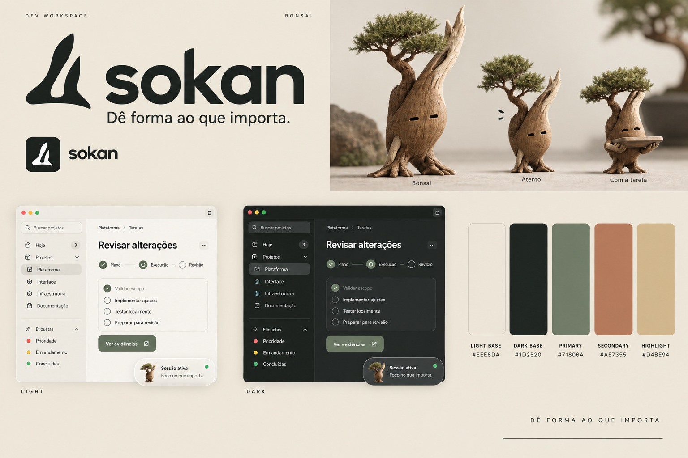
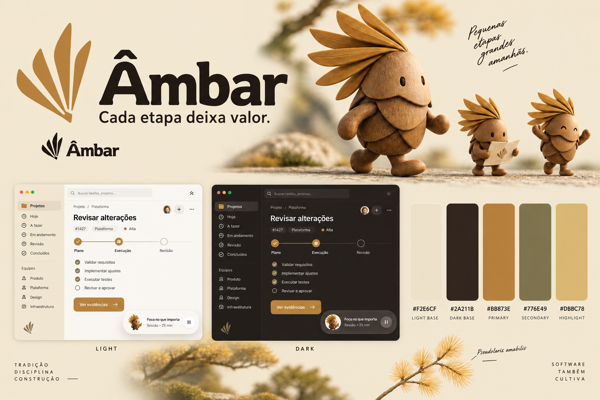
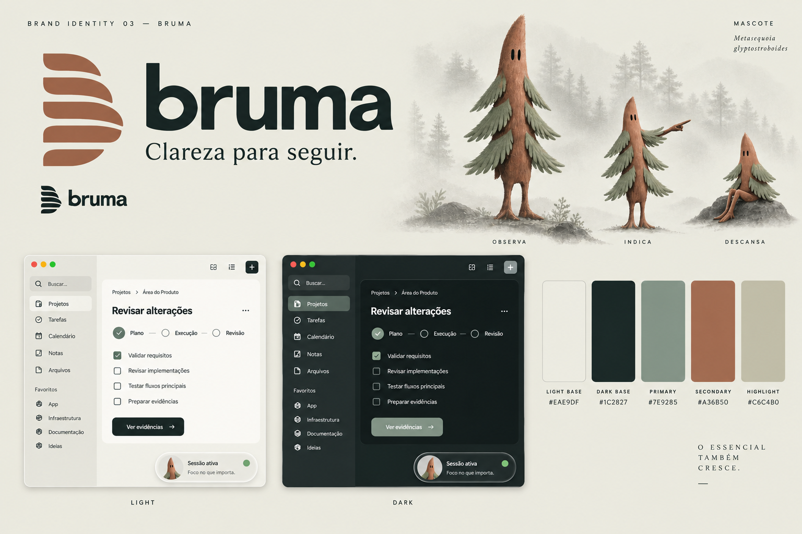
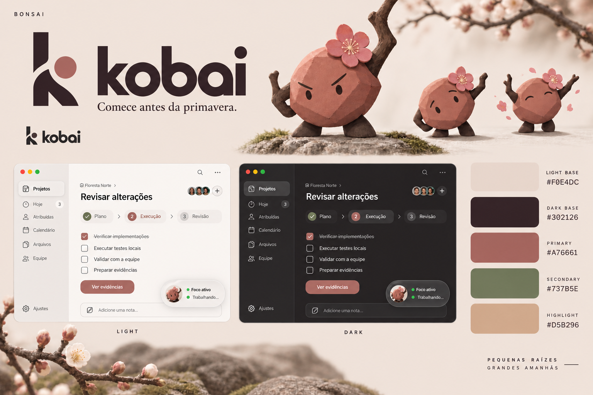
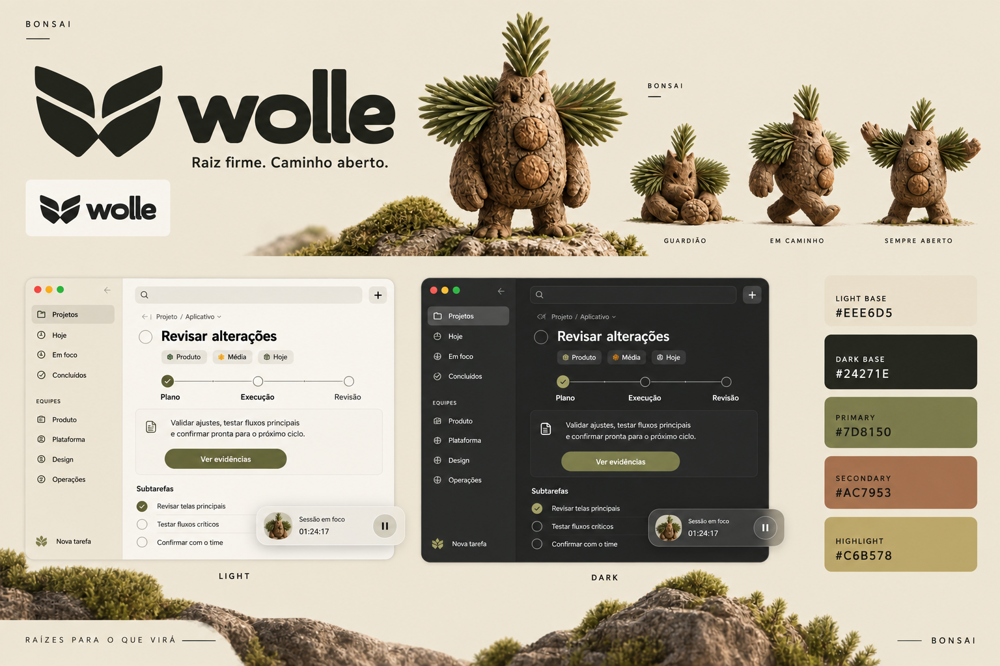
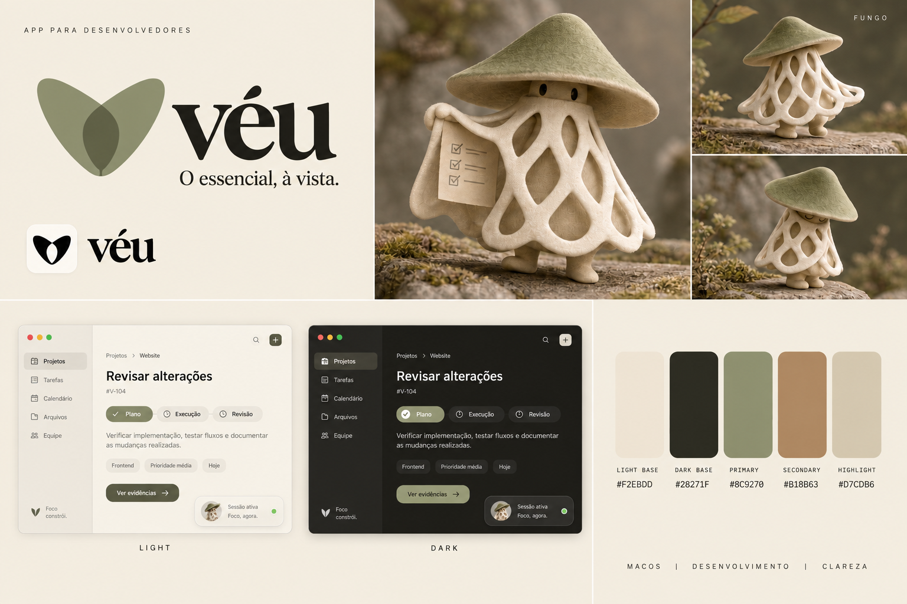
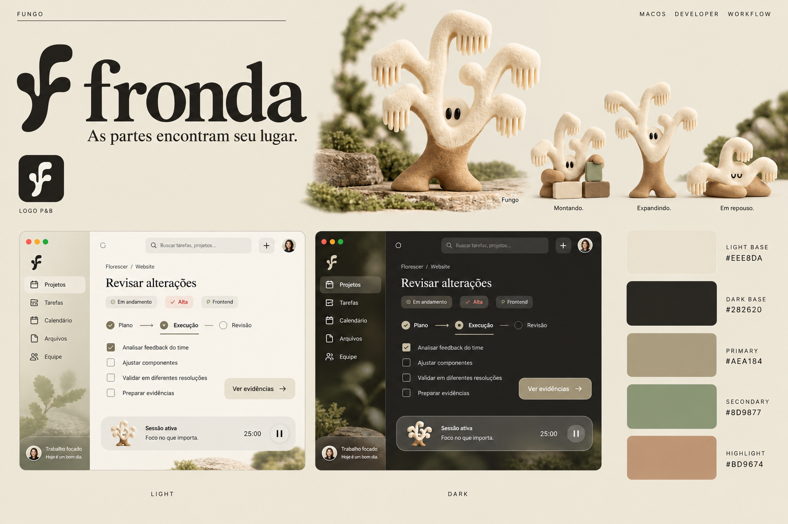
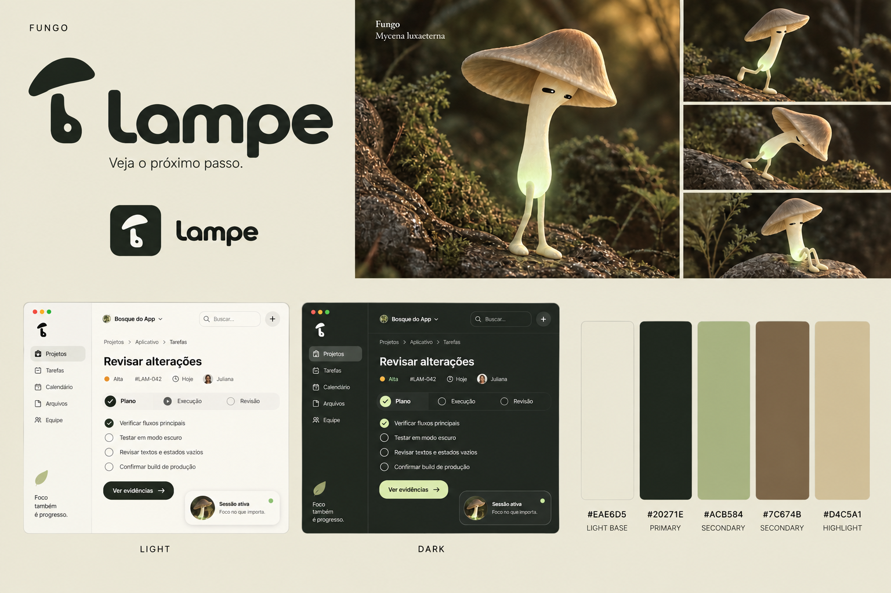
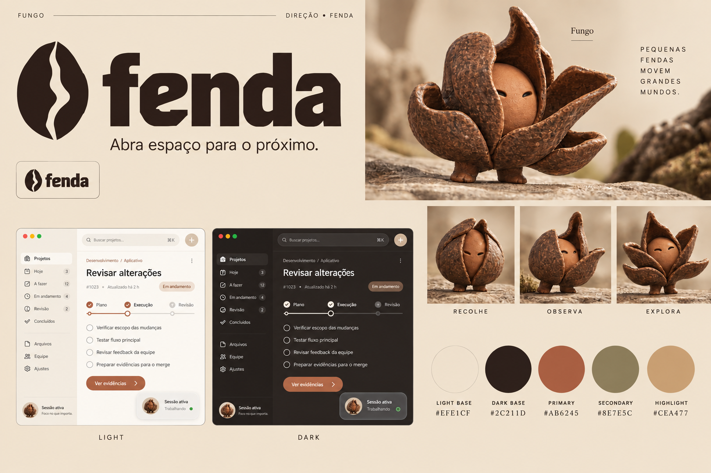

# Identidade de produto — 10 direções

Data: 25/09/2026 · Situação: Fronda escolhida pelo usuário para aprofundamento. As demais direções permanecem como histórico de exploração.

Preparei dez pranchas com nome, logo, mascote em poses, paleta terrosa e aplicação conceitual light/dark para o app. Geração pela ferramenta nativa image_gen, uma imagem por direção, seguida de uma revisão de contraste. A galeria está em [galeria.html](galeria.html).

## Como interpretar a pesquisa

Bonsai é uma técnica de cultivo, não uma espécie. A seleção reúne raridade documentada, formas incomuns e potencial de marca; não é um ranking científico das dez espécies mais raras ou bonitas. Não atribuo uma categoria de ameaça quando a fonte só registra escassez local. Os significados abaixo são narrativas criativas propostas, salvo a origem factual explicitada.

Li README.md e docs/SPEC.md do app e o uso de glassEffect na Session Island. O vínculo de produto é orientar trabalho, preservar contexto, acompanhar execução e inspecionar evidências. As imagens não são capturas do app nem propõem acrescentar calendários, equipes ou outros controles incidentais desenhados pelo gerador.

## Recomendações

- **Sokan:** melhor conexão entre natureza, direção humana e trabalho cultivado; símbolo compacto.
- **Wolle:** referência botânica mais rara entre as árvores e personagem robusto para vídeos e interface.
- **Véu:** personalidade mais distinta entre os fungos e conexão mais direta com transparência.
- **Ruga:** alternativa de nome curto e bom repertório de revisão; avaliar conotação de envelhecimento.

Não recomendo adotar os nomes **Kobai** ou **Fenda** nesta forma devido aos usos encontrados em tecnologia. Podemos preservar as direções visuais e refazer esses nomes depois da escolha. Esta é uma triagem web parcial, não uma pesquisa de registro de marca.

## Paletas

Ordem das cores: base clara / base escura / principal / secundária / realce. As cores não representam, sozinhas, um sistema semântico completo. Texto de conteúdo usa a base escura sobre clara e vice-versa. Cor de marca não substitui estados de sucesso, alerta ou erro. Não usar automaticamente texto branco sobre os acentos médios.

| Direção | Light | Dark | Principal | Secundária | Realce |
|---|---|---|---|---|---|
| Sokan | #EEE8DA | #1D2520 | #71806A | #AE7355 | #D4BE94 |
| Âmbar | #F2E6CF | #2A211B | #BB873E | #776E49 | #DBBC78 |
| Bruma | #EAE9DF | #1C2827 | #7E9285 | #A36B50 | #C6C4B0 |
| Kobai | #F0E4DC | #302126 | #A76661 | #737B5E | #D5B296 |
| Wolle | #EEE6D5 | #24271E | #7D8150 | #AC7953 | #C6B578 |
| Véu | #F2EBDD | #28271F | #8C9270 | #B18B63 | #D7CDB6 |
| Fronda | #EEE8DA | #282620 | #AEA184 | #8D9877 | #BD9674 |
| Lampe | #EAE6D5 | #20271E | #ACB584 | #7C674B | #D4C5A1 |
| Fenda | #EFE1CF | #2C211D | #AB6245 | #8E7E5C | #CEA477 |
| Ruga | #F1E5DA | #302521 | #BD8974 | #858364 | #D7B49B |

## As dez propostas

### 01 — Sokan · Bonsai

**Referência:** *Juniperus chinensis var. sargentii*. **Pronúncia:** so-KAN.

**Fato botânico:** Juníperos de Itoigawa apresentam troncos retorcidos, madeira morta e folhagem em massas; o estilo sokan reúne dois troncos desiguais numa base comum.

**Raridade:** Shimpaku é uma referência valorizada no bonsai; não foi estabelecido como uma das espécies mais raras do mundo. A singularidade aqui está na forma, na madeira exposta e nos exemplares antigos.

**Origem e significado proposto:** Do estilo de bonsai com dois troncos e uma raiz compartilhada. Para o produto: autonomia com direção comum.

**Assinatura:** “Dê forma ao que importa.”

**Mascote:** Seguro, paciente, criterioso. Um pequeno guardião de madeira, com humor seco.

**Uso em produto e conteúdo:** Na interface, inclina a copa enquanto acompanha uma execução; para revisão, ergue a pequena bandeja com o trabalho. Em posts: a série «Dar forma», mostrando antes e depois.

**Força:** Melhor conexão conceitual com o app: cultivar o contexto, orientar o trabalho e revisar o resultado.

**Ponto de atenção:** A textura realista do mascote precisará de uma versão simplificada para 24–32 px. O nome exige testar a pronúncia em português.

**Nome:** Busca preliminar encontrou uso de Sokan por uma empresa no LinkedIn; não houve verificação de disponibilidade de marca. [Uso encontrado](https://www.linkedin.com/company/sokaan).

**Fontes:** [Referência botânica](https://www.bonsai-nbf.org/blog-archive/2020/10/16/historical-tree-spotlight-the-logo-tree) · [Complemento](https://bonsaitoday.com/articles/basics/styles/sokan-double-trunk-style/).

**Arquivos:** [imagem v2](images/01-sokan-v2.png) · [prompt inicial](prompts/01-sokan.txt) · [prompt da revisão](prompts/01-sokan-v2.txt). **Feedback:** alternativa preservada como histórico; não escolhida nesta rodada.

### 02 — Âmbar · Bonsai

**Referência:** *Pseudolarix amabilis*. **Pronúncia:** ÂM-bar.

**Fato botânico:** Pseudolarix amabilis muda para dourado vivo antes de perder as agulhas no outono; há exemplar de penjing na coleção chinesa do museu.

**Raridade:** A National Bonsai Foundation descreve o golden-larch como uma conífera rara e incomum da China. Isso não estabelece um ranking mundial nem uma categoria atual de ameaça.

**Origem e significado proposto:** Palavra portuguesa associada à matéria dourada e ao tempo. A conexão com a espécie vem da folhagem de outono; não é seu nome botânico nem uma afirmação sobre sua resina.

**Assinatura:** “Cada etapa deixa valor.”

**Mascote:** Acolhedor, aplicado e otimista. Um artesão de madeira com escamas e um leque dourado.

**Uso em produto e conteúdo:** As placas do corpo e o leque criam movimentos simples de antecipação e celebração. Em posts: pequenas entregas que se acumulam; em vídeo, ele constrói algo peça a peça.

**Força:** A paleta mais quente; mascote fácil de imaginar em animação, adesivo ou objeto físico.

**Ponto de atenção:** O nome é uma palavra muito usada comercialmente; diferenciação e busca orgânica tendem a exigir mais trabalho. A ilustração estiliza as agulhas como placas de madeira.

**Nome:** Disponibilidade comercial, domínio e identificadores não verificados.

**Fontes:** [Referência botânica](https://www.bonsai-nbf.org/chinese-collection).

**Arquivos:** [imagem v2](images/02-ambar-v2.png) · [prompt inicial](prompts/02-ambar.txt) · [prompt da revisão](prompts/02-ambar-v2.txt). **Feedback:** alternativa preservada como histórico; não escolhida nesta rodada.

### 03 — Bruma · Bonsai

**Referência:** *Metasequoia glyptostroboides*. **Pronúncia:** BRU-ma.

**Fato botânico:** Conífera caducifólia de origem chinesa e linhagem antiga; a referência visual combina ramos delicados, folhagem pareada e tons de cobre.

**Raridade:** Metasequoia glyptostroboides é classificada como Endangered no cadastro do Royal Botanic Garden Edinburgh. Rara na natureza não significa rara em cultivo.

**Origem e significado proposto:** Bruma é névoa. A proposta transforma a paisagem da metasequoia numa história de clareza progressiva: sair da incerteza e encontrar o próximo passo.

**Assinatura:** “Clareza para seguir.”

**Mascote:** Observador, contemplativo e preciso. Personagem esguio com ramos como uma pequena capa.

**Uso em produto e conteúdo:** Surge da névoa, aponta uma direção e se recolhe quando não é necessário. Em posts: explicar decisões complexas por etapas.

**Força:** Direção mais silenciosa e editorial; bom espaço visual para conteúdo e vidro.

**Ponto de atenção:** Bruma também pode comunicar falta de clareza. A promessa e a experiência precisam resolver essa ambiguidade. A copa deve ser simplificada para ícone.

**Nome:** Disponibilidade comercial, domínio e identificadores não verificados.

**Fontes:** [Referência botânica](https://rbge.gardenexplorer.org/taxon-11093.aspx) · [Complemento](https://www.kew.org/read-and-watch/gymnosperms-on-the-edge).

**Arquivos:** [imagem v2](images/03-bruma-v2.png) · [prompt inicial](prompts/03-bruma.txt) · [prompt da revisão](prompts/03-bruma-v2.txt). **Feedback:** alternativa preservada como histórico; não escolhida nesta rodada.

### 04 — Kobai · Bonsai

**Referência:** *Prunus mume 'Kobai'*. **Pronúncia:** ko-BAI.

**Fato botânico:** Prunus mume floresce em ramos ainda sem folhas. A cultivar 'Kobai' tem flores vermelhas semidobradas; o mascote usa uma flor rosa simplificada como licença visual.

**Raridade:** Escolha por beleza, contraste e floração de inverno, não por raridade global comprovada. Não confundir o valor de um bonsai antigo com a raridade da espécie.

**Origem e significado proposto:** Kobai vem do nome de uma cultivar de Prunus mume. A narrativa proposta é começar a florescer antes da estação mais favorável.

**Assinatura:** “Comece antes da primavera.”

**Mascote:** Determinado, expressivo e caloroso. Um broto de terracota com sobrancelhas fortes.

**Uso em produto e conteúdo:** Fecha a expressão ao investigar e abre a flor numa entrega concluída. Em posts: primeiros passos e pequenos recomeços.

**Força:** Bom repertório emocional e rosa terroso sem aparência de app infantil.

**Ponto de atenção:** Há uma empresa de software com o mesmo nome e atuação próxima. Eu preservaria a direção visual e substituiria o nome antes de avançar comercialmente.

**Nome:** COLISÃO ENCONTRADA: Kobai já atua com plataforma semântica e inteligência de dados. Nome não recomendado para adoção nesta rodada. [Uso encontrado](https://kobai.io/).

**Fontes:** [Referência botânica](https://plants.ces.ncsu.edu/plants/prunus-mume/) · [Complemento](https://www.bonsai-nbf.org/blog-archive/tag/Bonsai%2BCare).

**Arquivos:** [imagem v2](images/04-kobai-v2.png) · [prompt inicial](prompts/04-kobai.txt) · [prompt da revisão](prompts/04-kobai-v2.txt). **Feedback:** alternativa preservada como histórico; não escolhida nesta rodada.

### 05 — Wolle · Bonsai

**Referência:** *Wollemia nobilis*. **Pronúncia:** Pronúncia proposta: VÓ-le.

**Fato botânico:** A espécie foi encontrada viva em 1994 na Austrália. Tem casca muito particular e folhas achatadas; há registro de apresentação como bonsai pela Bonsai Society of Australia.

**Raridade:** Wollemia nobilis é criticamente ameaçada segundo Kew. É a referência com raridade botânica mais forte desta seleção de árvores.

**Origem e significado proposto:** Wolle é um recorte proposto de Wollemia. A história é preservar uma base valiosa e continuar crescendo; não atribuo ao recorte uma tradução tradicional.

**Assinatura:** “Raiz firme. Caminho aberto.”

**Mascote:** Firme, protetor e simpático. Um guardião robusto de cortiça e madeira com ramos laterais.

**Uso em produto e conteúdo:** Protege uma semente, caminha decidido e recebe o usuário. Em posts: bastidores, continuidade e cuidar do trabalho que já existe.

**Força:** Combina raridade real, silhueta forte e uma palavra curta que também funciona como nome do personagem.

**Ponto de atenção:** É preciso decidir e testar a pronúncia. Wolle também é uma palavra alemã ligada a lã; o recorte não é exclusivo por definição.

**Nome:** Disponibilidade comercial, domínio e identificadores não verificados.

**Fontes:** [Referência botânica](https://powo.science.kew.org/taxon/urn%3Alsid%3Aipni.org%3Anames%3A986236-1/general-information) · [Complemento](https://bonsai.asn.au/australian-plants-as-bonsai-2025/).

**Arquivos:** [imagem v2](images/05-wolle-v2.png) · [prompt inicial](prompts/05-wolle.txt) · [prompt da revisão](prompts/05-wolle-v2.txt). **Feedback:** alternativa preservada como histórico; não escolhida nesta rodada.

### 06 — Véu · Fungo

**Referência:** *Phallus indusiatus*. **Pronúncia:** VÉU.

**Fato botânico:** Phallus indusiatus possui um indúsio que lembra uma saia em rede; esse traço é a origem da capa e do símbolo com abertura central.

**Raridade:** Selecionado por morfologia extraordinária; não foi estabelecido como espécie globalmente rara. A referência não depende de uma alegação de ameaça.

**Origem e significado proposto:** Véu vem da estrutura rendada do fungo. Para o app, a metáfora é revelar o essencial com delicadeza e manter o restante organizado.

**Assinatura:** “O essencial, à vista.”

**Mascote:** Discreto, curioso e um pouco misterioso. Capa vazada de linho e chapéu baixo.

**Uso em produto e conteúdo:** Levanta uma dobra para revelar um resultado e recolhe a capa para indicar espera. Em vídeo, a malha cria um movimento reconhecível; em posts, revelações graduais.

**Força:** A conexão material mais direta com transparência e liquid glass. Mascote reconhecível mesmo sem um rosto grande.

**Ponto de atenção:** A renda exige redução forte no tamanho de interface. O nome pode sugerir esconder; a comunicação precisa enfatizar revelar.

**Nome:** Disponibilidade comercial, domínio e identificadores não verificados. Testar a escrita sem acento em endereços.

**Fontes:** [Referência botânica](https://qldfungi.org.au/wp-content/uploads/References/Downloads/Stinkhorn-Species-Descriptions-2017.pdf) · [Complemento](https://www.indexfungorum.org/names/NamesRecord.asp?RecordID=178961).

**Arquivos:** [imagem v2](images/06-veu-v2.png) · [prompt inicial](prompts/06-veu.txt) · [prompt da revisão](prompts/06-veu-v2.txt). **Feedback:** alternativa preservada como histórico; não escolhida nesta rodada.

### 07 — Fronda · Fungo

**Referência:** *Hericium coralloides*. **Pronúncia:** FRON-da.

**Fato botânico:** Hericium coralloides forma massas claras, ramificadas, com pequenos espinhos pendentes, sobre madeira morta.

**Raridade:** A raridade de Hericium varia por região. A escolha desta direção é pela estrutura coralina, sem alegar que está entre os fungos globalmente mais raros.

**Origem e significado proposto:** Fronda remete a ramagem. Aqui é uma metáfora visual para partes que se organizam num todo, sem atribuir folhas ao fungo.

**Assinatura:** “As partes encontram seu lugar.”

**Mascote:** Colaborativo, metódico e gentil. Pequeno coral terrestre de marfim, com vários ramos expressivos.

**Uso em produto e conteúdo:** Os ramos organizam blocos e depois se recolhem. Em posts: mostrar como contexto, execução e revisão se conectam.

**Força:** Mascote sem o chapéu convencional de cogumelo; bom potencial de gestos e composição.

**Ponto de atenção:** A silhueta pode parecer coral marinho ou árvore. Os espinhos pendentes precisam continuar sendo sua assinatura.

**Nome:** Disponibilidade comercial, domínio e identificadores não verificados.

**Fontes:** [Referência botânica](https://keys.lucidcentral.org/keys/v4/101-forest-fungi/web/resource/h/hericium%20coralloides.htm).

**Arquivos:** [imagem v2](images/07-fronda-v2.png) · [prompt inicial](prompts/07-fronda.txt) · [prompt da revisão](prompts/07-fronda-v2.txt). **Feedback:** SELECIONADA pelo usuário. Preferência confirmada: conjunto de nome, mascote e cores. Refinamento em ../fronda-refinement-v1/.

### 08 — Lampe · Fungo

**Referência:** *Mycena luxaeterna*. **Pronúncia:** LAM-pe.

**Fato botânico:** A espécie integra pesquisas brasileiras de fungos bioluminescentes. A imagem transforma o brilho esverdeado em um recurso de personagem, sem propor um produto fluorescente.

**Raridade:** Mycena luxaeterna tem registros de descoberta localizados na Mata Atlântica brasileira. Não usei esses registros para afirmar uma categoria atual de ameaça ou um ranking de raridade.

**Origem e significado proposto:** Lampe é um nome proposto por associação sonora a lâmpada e lampejo. A espécie fornece a ideia de luz discreta que ajuda a enxergar.

**Assinatura:** “Veja o próximo passo.”

**Mascote:** Curioso, atento e leve. Um explorador pequeno e esguio, com luz suave no corpo.

**Uso em produto e conteúdo:** Inclina o chapéu para observar e ilumina o próximo passo. Na interface, brilho mínimo só em eventos relevantes; em vídeo, funciona bem em cenas noturnas.

**Força:** Origem brasileira e narrativa muito clara de orientação. Bom contraste entre personagem delicado e app técnico.

**Ponto de atenção:** Há software e app com Lampe no nome. A silhueta alongada pede uma versão compacta para menu bar.

**Nome:** USOS ENCONTRADOS: biblioteca probabilists/lampe e app Lampe. Não considerar o nome liberado. [Uso encontrado](https://github.com/probabilists/lampe).

**Fontes:** [Referência botânica](https://revistapesquisa.fapesp.br/luz-na-escuridao/) · [Complemento](https://revistapesquisa.fapesp.br/luzes-vivas/).

**Arquivos:** [imagem v2](images/08-lampe-v2.png) · [prompt inicial](prompts/08-lampe.txt) · [prompt da revisão](prompts/08-lampe-v2.txt). **Feedback:** alternativa preservada como histórico; não escolhida nesta rodada.

### 09 — Fenda · Fungo

**Referência:** *Chorioactis geaster*. **Pronúncia:** FEN-da.

**Fato botânico:** O corpo marrom abre-se em quatro a oito pontas. A direção usa essa transformação como repertório de expressão, sem desenhar a estrela genérica associada a IA.

**Raridade:** Chorioactis geaster é descrito como raro pela Texas Wildlife Association, com ocorrências no Texas, em pequenas áreas de Oklahoma e no Japão.

**Origem e significado proposto:** Fenda é a abertura que transforma a cápsula fechada em outra forma. Para a marca: abrir espaço, destravar e tornar algo visível.

**Assinatura:** “Abra espaço para o próximo.”

**Mascote:** Reservado por fora, acolhedor por dentro. Personagem de cápsula e argila que se abre aos poucos.

**Uso em produto e conteúdo:** Uma sequência de fechado, observando e aberto já dá um arco completo de animação. Em posts: revelar novidades e explicar obstáculos superados.

**Força:** Um dos melhores mecanismos de movimento e transformação das dez opções.

**Ponto de atenção:** Existe Fenda Technology, inclusive com software e aplicativos. Eu manteria o mascote e reabriria o nome antes de adoção comercial.

**Nome:** COLISÃO ENCONTRADA: Fenda Technology e apps Fenda. Nome não recomendado para adoção nesta rodada. [Uso encontrado](https://www.fenda.com/en/).

**Fontes:** [Referência botânica](https://www.texas-wildlife.org/wp-content/uploads/2024/02/Feb-2024-Discovering-Decomposers.pdf).

**Arquivos:** [imagem v2](images/09-fenda-v2.png) · [prompt inicial](prompts/09-fenda.txt) · [prompt da revisão](prompts/09-fenda-v2.txt). **Feedback:** alternativa preservada como histórico; não escolhida nesta rodada.

### 10 — Ruga · Fungo

**Referência:** *Rhodotus palmatus*. **Pronúncia:** RU-ga.

**Fato botânico:** O fungo conhecido como wrinkled peach tem coloração de pêssego e uma malha pronunciada sobre o chapéu; cresce associado à madeira em decomposição.

**Raridade:** Há registros de escassez regional de Rhodotus palmatus. Não extrapolei essa condição para todas as regiões ou para espécies semelhantes recentemente separadas.

**Origem e significado proposto:** Ruga vem da superfície reticulada do fungo. A proposta valoriza detalhes, experiência e marcas do trabalho, com um nome cotidiano de quatro letras.

**Assinatura:** “Cada detalhe conta.”

**Mascote:** Minucioso, perspicaz e levemente irônico. Um pequeno revisor com chapéu texturizado e botas.

**Uso em produto e conteúdo:** Usa a lupa para conferir detalhes, ergue a sobrancelha diante de uma dúvida e relaxa ao concluir. Em posts: «o detalhe que passou batido».

**Força:** Nome curto, boa personalidade e vínculo direto com revisão e evidências.

**Ponto de atenção:** Ruga pode lembrar envelhecimento ou cosméticos. O mascote ficou mais próximo do cogumelo simpático convencional; a malha e a atitude precisam sustentar a diferença.

**Nome:** Disponibilidade comercial, domínio e identificadores não verificados.

**Fontes:** [Referência botânica](https://www.naturespot.org/species/wrinkly-peach) · [Complemento](https://roughamestatetrust.org/wp-content/uploads/2024/09/Woodland-Fungi-Survey-on-RE-summary-2020-21.pdf).

**Arquivos:** [imagem v2](images/10-ruga-v2.png) · [prompt inicial](prompts/10-ruga.txt) · [prompt da revisão](prompts/10-ruga-v2.txt). **Feedback:** alternativa preservada como histórico; não escolhida nesta rodada.

## Decisões visuais e limites

As assinaturas foram pensadas com poucos elementos e uma versão monocromática. Os mascotes compartilham materialidade terrosa, mas têm silhuetas e mecanismos de movimento diferentes. Para a interface, o objetivo é um avatar discreto, com aparições em estados relevantes; para redes e vídeos, um personagem com gestos reconhecíveis.

O vidro pertence a controles e superfícies do produto. A revisão v2 usa fundo sólido nas áreas da prancha com logo e legenda para corrigir o baixo contraste da geração inicial. Light e dark são aplicações conceituais da mesma paleta. O efeito nativo, contraste sobre wallpapers, Reduce Transparency, Reduce Motion e as escalas de ícone não foram validados no app nesta rodada.

As imagens são raster, não logos vetoriais finais, modelos 3D ou personagens já preparados para animação. Os desenhos são interpretações: agulhas, flores, cascas e corpos de fungos foram simplificados. Textos pequenos e pixels das cores podem variar na geração; os códigos desta tabela são a referência exata. A flor de Kobai foi estilizada, não representa com fidelidade a cultivar de flores semidobradas.

## Arquivos e escopo

Todos os entregáveis estão em output/brand-exploration/2026-09-25/: dez PNGs v2, galeria.html, CATALOGO.md, concepts.json, research.json, generation-manifest.json e vinte prompts. Os originais v1 continuam no diretório de imagens geradas do Codex, indicados no manifesto. Nenhum arquivo Swift, configuração, dependência ou nome instalado do app foi alterado. Nenhum commit, push ou publicação.

## O que validar para escolher

1. Nome falado: é fácil ouvir uma vez, lembrar e escrever? Funciona em “abre o ...” e “manda para o ...”?
2. Logo: a silhueta funciona sem o nome, em preto e branco e no Dock?
3. Personagem: você quer vê-lo diariamente? Tem personalidade suficiente para falar, observar, errar e comemorar sem cansar?
4. Tema: comparar conforto de leitura e tons terrosos em light/dark; não decidir apenas pela beleza do render.
5. Depois da shortlist: pesquisar disponibilidade de marca, domínios e identificadores; redesenhar o logo vetorialmente e validar tamanhos e contraste no app real.

**Execuções:** geração e inspeção visual das pranchas; verificação dos arquivos e da galeria documentada em VERIFICACAO.md. Não rodei testes, lint ou build do app, pois esta rodada entrega exploração de marca e não implementação.

