# Demonstração prática do Fronda

Abra **Demo Fronda · Cadastro de contato** na lista de projetos do Fronda.
Todos os dados são fictícios. Cada tarefa usa uma worktree própria.

A tarefa 09 já tem correção real, três PASS de sintaxe e cenários antes/depois. Ela permanece **Parcial**, com revisão final e evidências complementares pendentes. Veja [a conferência e os limites](CONFERENCIA.md).

## Apresentação em 5 minutos

1. **Problema (30 s):** abra http://127.0.0.1:8858, clique em “Preencher exemplo” e em “Salvar contato”. O apelido está marcado como opcional, mas impede salvar.
2. **Organização (1 min):** abra a tarefa **01 · Começar aqui**. Mostre critérios, escopo, contexto selecionado e as etapas do plano. Esta tarefa está no início para você poder executar a jornada ao vivo.
3. **Execução real (1 min):** abra **09 · Correção real**. Ela usa o Codex e registra investigação, plano e alteração. Compare o código e as evidências antes/depois.
4. **Controle (1 min):** mostre **02 PASS**, **03 FAIL**, **04 BLOCKED** e **05 STALE**, na aba Validação de cada tarefa.
5. **Retomada (30 s):** mostre **06 Pausa**, **07 Cancelamento** e **08 Orçamento**. Explique que esses estados ficam explícitos e que arquivos já preparados são preservados.
6. **Fechamento (1 min):** volte à tarefa **09** para mostrar o resultado, a revisão e as pendências reais. A entrega por commit/PR é uma decisão posterior.

> Frase de apoio: “O Fronda organiza o trabalho da IA em etapas, limita onde ela pode alterar, executa verificações e mantém as evidências ligadas à versão do código.”

## Fluxo principal

```mermaid
flowchart LR
  A[Objetivo e critérios] --> B[Contexto selecionado]
  B --> C[Aprovar investigação]
  C --> D[Reproduzir o problema]
  D --> E[Plano de correção]
  E --> F[Aprovar plano]
  F --> G[Alterar worktree isolada]
  G --> H[Validar sintaxe]
  H --> I[Conferir formulário]
  I --> J[Revisão independente]
  J --> K[Revisão humana e entrega]
```



## O que cada tarefa demonstra

| Tarefa | Como apresentar | Evidência preparada |
| --- | --- | --- |
| 01 · Começar aqui | Início de uma execução guiada | Contexto, critérios e reprodução anterior |
| 02 · PASS | Comando aprovado executa e termina com código 0 | Três verificações de sintaxe |
| 03 · FAIL | Um erro interrompe a validação | Sintaxe inválida apenas na worktree desta tarefa |
| 04 · BLOCKED | Uma autorização pendente impede o comando | O comando não aprovado não executa |
| 05 · STALE | Uma alteração invalida evidências anteriores | Código mudou depois do PASS |
| 06 · Pausa | Interromper e retomar de forma explícita | Tarefa PAUSED |
| 07 · Cancelamento | Cancelar preservando o trabalho preparado | Tarefa CANCELLED |
| 08 · Orçamento | O contexto precisa caber no limite | Preparação bloqueada com teto de 1.000 tokens |
| 09 · Correção real | Caminho principal com Codex | Investigação, plano, alteração e conferência |

Um PASS de sintaxe não garante que o formulário funciona. Tarefas auxiliares podem continuar **Parcial** porque representam um caso específico, sem concluir todo o fluxo. Evidências antigas podem aparecer como STALE no histórico após ajuste do catálogo.

## Cenários funcionais

O roteiro completo está em `/Users/pedronazarito/Developer/fronda-demo-formulario/CENARIOS.md`:
apelido vazio, espaços ou preenchido; nome/e-mail inválidos; normalização; duplicidade;
texto literal; duplo envio; falha de conexão; teclado, largura pequena e tema escuro.
O relatório de conferência diferencia observação na interface, inspeção de código e verificações não executadas.

## Reabrir o formulário

Se os servidores locais estiverem encerrados, inicie em terminais separados:

Versão inicial, porta 8858:

```sh
cd /Users/pedronazarito/Developer/fronda-demo-formulario
/Users/pedronazarito/.local/bin/node serve.mjs 8858
```

Versão da tarefa 09, porta 8859:

```sh
cd '/Users/pedronazarito/Library/Application Support/Harness/worktrees/78fdd83c-01ea-433a-8ad8-8737df4f9979'
/Users/pedronazarito/.local/bin/node serve.mjs 8859
```

Os cadastros ficam apenas na memória do processo. Reiniciar o servidor limpa os contatos da demo.

## Limites desta preparação

- Não há remoto Git, push, PR ou publicação neste projeto.
- Falha real de autenticação/provider, conflitos com trabalho de outras pessoas e entrega remota exigem outro ambiente; não são apresentados como sucesso.
- Fila, preparação e execução são estados transitórios, visíveis ao iniciar/retomar.
- O código do Fronda não foi alterado para fabricar estados. Os exemplos foram criados pela API pública do próprio aplicativo.
- Nenhum arquivo de teste ou mock foi criado. Os comandos de sintaxe não são lint, testes funcionais nem build do Fronda.
